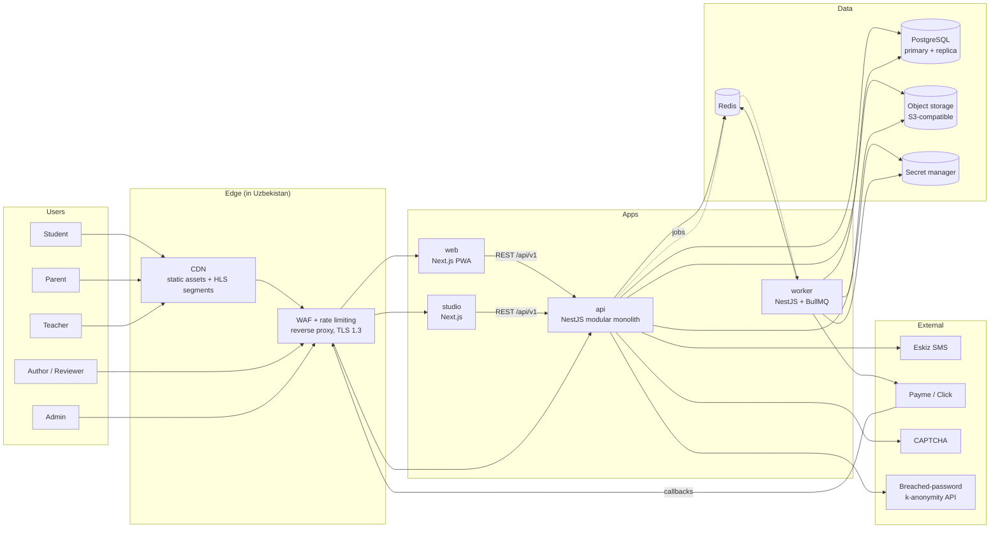
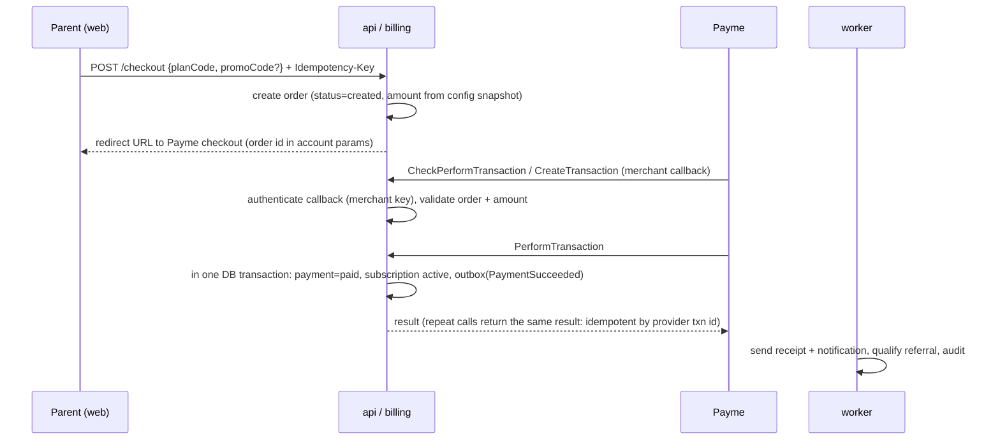

# MathPath: Architecture Overview

|         |                                                                                                         |
| ------- | ------------------------------------------------------------------------------------------------------- |
| Status  | Draft for approval (Phase 3)                                                                            |
| Version | 0.1.0                                                                                                   |
| Date    | 2026-11-15                                                                                              |
| Related | [PRD](PRD.md) · [Database schema](database-schema.md) · [API contract](api/openapi.yaml) · [ADRs](adr/) |

This document explains how the system is put together and _why_. The ADRs
in `docs/adr/` record each major decision with the alternatives considered.

---

## 1. Architectural style in one paragraph

MathPath is a **modular monolith** written in **TypeScript**. It is one API
codebase (NestJS) split into strict domain modules, plus a **worker** process
built from the same codebase for background jobs. Two **Next.js PWA**
front-ends sit on top of it: `web` for students, parents and teachers, and
`studio` for authors, reviewers and admins. Everything lives in one
**pnpm + Turborepo monorepo**. The data stores are **PostgreSQL** (source of truth),
**Redis** (cache, rate limits, queues) and **S3-compatible object storage**
(media, exports, certificates). Everything runs in Docker and is hosted in an
Uzbek data centre ([ADR-0001](adr/0001-typescript-monorepo.md),
[ADR-0002](adr/0002-modular-monolith.md)).

> **Why not microservices?** One person maintains this system. A modular monolith
> gives the same boundaries with one deploy, one database transaction and one
> place to debug. Modules talk through public interfaces and domain events, so any
> module can later be extracted into a service (video processing and payments are
> the likely first ones) without rewriting callers.

---

## 2. System context



**Hosting rule:** every component that stores or processes personal data
(Postgres, Redis, object storage, API, worker, logs) runs in a data centre in
Uzbekistan, as the personal data law requires. The CDN carries only static assets and
encrypted video segments. Its edge should also be local, or the video must stay
encrypted with keys served only from our API (see §7.3).

---

## 3. Repository layout (monorepo)

```
mathpath/
├── apps/
│   ├── web/          # Next.js PWA: student, parent, teacher (public subdomain)
│   ├── studio/       # Next.js: authors, reviewers, admins (staff subdomain, 2FA)
│   ├── api/          # NestJS HTTP API (modular monolith)
│   └── worker/       # NestJS standalone app: BullMQ consumers, cron jobs
├── packages/
│   ├── contracts/        # OpenAPI spec + generated TS types and client
│   ├── question-engine/  # Parameterised question generation + grading (server-only)
│   ├── question-render/  # Client-safe rendering of question instances (no answers)
│   ├── config/           # Typed loader for business-rule config (Zod-validated)
│   ├── i18n/             # Message catalogues uz-Latn / ru / en + helpers
│   ├── ui/               # Accessible design-system components (shared by web/studio)
│   ├── db/               # Kysely schema types, migrations (up/down), seeds
│   └── tooling/          # eslint, prettier, tsconfig presets
├── config/           # Business rules (YAML), one file per domain, see §6
├── infra/            # docker-compose, Dockerfiles, reverse proxy/WAF config
├── docs/             # This folder
└── .github/workflows # CI: lint, typecheck, test, SAST, dependency scan, DAST
```

**Why two front-end apps instead of one?**
The student bundle never contains CMS or admin code (smaller and faster on 3G,
and a smaller attack surface). Staff live on their own subdomain with a stricter
CSP, mandatory 2FA and an optional IP allow-list. The alternative was one app with
route groups. It is simpler to deploy, but it mixes the security policies of staff
and children.

**Why `question-engine` and `question-render` are separate:** the engine
knows the answers and must never be bundled into a browser app. A lint rule
(`no-restricted-imports`) blocks `web` from importing it. `studio` gets the engine's
preview only through an API call.

---

## 4. API modules (bounded contexts)

| Module          | Owns                                                                                                     | Talks to                                               |
| --------------- | -------------------------------------------------------------------------------------------------------- | ------------------------------------------------------ |
| `identity`      | Users, roles, phone OTP, passwords, sessions, refresh tokens, 2FA, child PIN login                       | `risk`, `audit`, `notifications`                       |
| `family`        | Parent–child links, parental consent records                                                             | `identity`, `audit`                                    |
| `privacy`       | Data export, account deletion (grace period → hard delete)                                               | All modules through a `PersonalDataProvider` interface |
| `risk`          | Device fingerprints, velocity rules, risk score, CAPTCHA escalation, manual review queue                 | `identity`, `billing`, `audit`                         |
| `catalogue`     | Tracks, courses, chapters, topics, knowledge graph (read side, published only)                           | `content` (published versions)                         |
| `content`       | Drafts, versions, review workflow, question templates, media assets (CMS write side)                     | `catalogue`, `media`, `audit`                          |
| `media`         | Uploads, transcoding jobs, HLS keys, signed playback URLs                                                | `worker`, `entitlements`                               |
| `assessment`    | Assessments, attempts, item generation, server-side grading, anti-cheat signals                          | `question-engine`, `learning`, `risk`                  |
| `learning`      | Topic progress, mastery, spaced repetition, diagnostic → learning path, gap routing                      | `catalogue`, `assessment`                              |
| `entitlements`  | "May this user access X?" (free tier, subscription, daily limits)                                        | `billing`, `catalogue`                                 |
| `billing`       | Plans (from config), subscriptions, payments, refunds, provider adapters, promo codes, trials, referrals | `entitlements`, `risk`, `notifications`, `audit`       |
| `gamification`  | XP ledger, levels, streaks, badges, quests, leagues                                                      | Domain events from `learning` and `assessment`         |
| `classroom`     | Classes, join codes, assignments, class analytics                                                        | `assessment`, `learning`                               |
| `reporting`     | Student and parent dashboards, weekly reports, predicted score                                           | Read models, replica DB                                |
| `certificates`  | Issuing, signing, public verification                                                                    | `learning`                                             |
| `notifications` | SMS, email, in-app; templates via i18n; quiet hours                                                      | `worker`                                               |
| `audit`         | Append-only audit log                                                                                    | Everyone writes, `admin` reads                         |
| `admin`         | User management, moderation, refunds, risk reviews                                                       | Facades over the modules above                         |

**Module rules** (enforced with `eslint-plugin-boundaries`):

1. A module may import another module only through its `index.ts` public API.
2. No module reads another module's tables directly. Reporting is the only
   exception: it reads views on the replica.
3. Side effects across modules go through **domain events** written to an
   **outbox table** in the same transaction, then published by the worker
   ([ADR-0007](adr/0007-outbox-domain-events.md)). For example,
   `assessment.AttemptGraded` → `learning` updates mastery → `gamification`
   awards XP. A crash can't award XP for an attempt that wasn't saved, and can't
   lose XP for one that was.

---

## 5. Key flows

### 5.1 Answering a question (the hot path)

```mermaid
sequenceDiagram
  participant C as web (student)
  participant API as api / assessment
  participant QE as question-engine
  participant DB as Postgres
  participant OB as outbox → worker

  C->>API: POST /attempts {type: practice, topicId}
  API->>API: entitlements.check(user, topic) and daily limit
  API->>QE: generate(templateVersion, seed)
  QE-->>API: {params, renderedStem, choices, answerKey}
  API->>DB: insert attempt + attempt_items (params, answerKey stored server-side)
  API-->>C: item without answerKey
  C->>API: POST /attempts/{id}/items/{n}/answer {response, clientTimeMs}
  API->>QE: grade(answerKey, response)
  QE-->>API: {correct, score, feedbackCode}
  API->>DB: update item; insert outbox(AttemptItemAnswered)
  API-->>C: {correct, hint or solution per policy}
  OB-->>OB: learning.updateMastery, gamification.awardXp (idempotent)
```

- **Seeds:** `seed = HMAC(serverSecret, attemptId:position)`. The same item
  can always be regenerated for audit, and the client can't predict it.
  The generated `params` are also stored, so grading never depends on
  regenerating.
- **Feedback policy** (in config): practice gives a hint after the first wrong
  answer and the full solution after the second. Mastery tests and mock exams
  give no feedback until submission.
- **Anti-cheat signals** recorded on each answer: server-measured time to answer,
  focus changes reported by the client (advisory only), and the response itself.
  A worker job compares patterns across students in the same class and window
  (abnormally fast, identical wrong answers) and raises `risk` signals. It
  never blocks a child automatically. A teacher or admin reviews.

### 5.2 Adaptive gap routing

The adaptive algorithm in plain words. The code version will be in
`learning/gap-router.ts` with comments explaining each rule.

```
on MasteryTestFailed(student, topic):
  weakPrereqs = prerequisites(topic)                     # knowledge-graph edges
                .filter(p => mastery(student, p) < threshold
                          OR isStale(student, p))         # last mastered > staleDays
                .sortBy(p => mastery(student, p))         # weakest first
  if weakPrereqs is empty:
      recommend: retry practice on `topic` (harder items first excluded)
  else if detourDepth(student) >= maxDepth OR detoursToday >= maxPerDay:
      recommend: practice on `topic`, and flag for teacher/parent
  else:
      p = weakPrereqs[0]
      start mini-diagnostic on p (3–5 items)
      if passed: mark p refreshed and return to `topic`
      else: push p onto learning path before `topic`
            (recursion happens naturally the next time p's test is failed)
```

All thresholds (`threshold`, `staleDays`, `maxDepth`, `maxPerDay`) live in
`config/learning.yaml`. Gap routing is implemented behind a `GapRouter`
interface, so a statistical model (BKT/IRT) can replace it later
([ADR-0006](adr/0006-rule-based-adaptivity.md)).

### 5.3 Diagnostic → learning path

1. The diagnostic selects items by walking the knowledge graph from the course's
   "leaf" topics downward (binary-search style): a correct answer on a topic
   marks its prerequisites as _probably mastered_, a wrong answer probes
   them.
2. The result is a mastery estimate per topic.
3. The learning path is a topological order of the course's topic graph,
   minus topics estimated as mastered, recomputed whenever mastery changes.

### 5.4 Sign-up and login

- **Parent:** phone → SMS OTP (rate-limited, CAPTCHA escalates with risk) →
  set password (breached-password check) → add child (first name, nickname,
  grade, birth year) → consent screen → done.
- **Child:** signs in on the parent's device through "switch profile", or on
  another device with the **family code + child's 4–6 digit PIN**, which
  is rate-limited and locks after repeated failures. The child has no phone
  and no password, following data minimisation.
- **Tokens** ([ADR-0005](adr/0005-auth-sessions-and-tokens.md)): an access token
  (JWT, EdDSA, 15 min) and an opaque refresh token (30 days, rotated on every use;
  reuse of an old token revokes the whole session family). The web apps receive
  both as `HttpOnly; Secure; SameSite=Lax` cookies scoped to the API domain, and
  JavaScript never sees a token. Future mobile apps use the same endpoints with
  `Authorization: Bearer` and secure device storage.
- **CSRF:** SameSite cookies plus a double-submit token header
  (`X-CSRF-Token`) on every state-changing request from the browser.

### 5.5 Payments (Payme example)



- Each provider is an adapter behind `PaymentProvider`
  (`createCheckout`, `handleCallback`, `chargeSavedToken`, `refund`,
  `getStatus`) ([ADR-0008](adr/0008-payment-provider-adapters.md)).
- **Callback authentication is provider-specific** and is always checked
  before the body is trusted. Payme authenticates its merchant callbacks with
  credentials in the `Authorization` header. Click sends a `sign_string` hash
  that we recompute. Exact algorithms are taken from each provider's current
  documentation when the adapters are written.
- **Idempotency** works at three levels: an `Idempotency-Key` on our own POSTs,
  a unique `(provider, provider_txn_id)`, and a state machine that allows only
  forward transitions.
- **Card data never reaches us.** Card entry happens on the provider's page or
  SDK; we store only the provider's token, last 4 digits and expiry month
  and year.
- **Renewals:** a worker job charges the saved token N days before
  `current_period_end`, retries according to config, and moves the subscription
  to `past_due`, then `expired`.
- **Amounts** are stored as integers in **tiyin** (1 UZS = 100 tiyin), never
  as floats.

---

## 6. Configuration (business rules)

Business rules are **data, not code**. Each domain has a YAML file in `config/`,
loaded at boot by `packages/config`, validated with Zod, and exposed as typed
objects. A bad config value stops the app at startup instead of failing at
runtime.

| File                       | Examples                                                                          |
| -------------------------- | --------------------------------------------------------------------------------- |
| `config/learning.yaml`     | `masteryThreshold: 0.8`, SM-2 intervals, gap-routing limits, hint/solution policy |
| `config/billing.yaml`      | Plans, prices in tiyin, trial days, family max children, renewal retry schedule   |
| `config/gamification.yaml` | XP per event, level curve, streak rules, league sizes, quiet hours                |
| `config/limits.yaml`       | Free daily exercises, concurrent sessions, devices per account, API rate limits   |
| `config/risk.yaml`         | OTP limits per phone/IP/device, blocked prefixes, risk score weights and actions  |
| `config/content.yaml`      | Supported locales, question types enabled, video length limits                    |

**Environment variables** cover deployment settings and secrets only (database URL,
Redis URL, provider keys). Each app ships a `.env.example`. In production,
secrets come from the secret manager and are injected at start-up. They are never
committed and never written to config files.

**Why YAML in the repo and not an admin UI?** Changes are reviewed in pull
requests, versioned and tested. The alternative, an admin settings screen, is
more convenient but untested and easier to misconfigure. Prices may move to the
admin UI later, with an audit trail, if they change often.

---

## 7. Cross-cutting concerns

### 7.1 Performance and slow networks

- **Rendering:** student pages use React Server Components where they help.
  The lesson player is a client component that loads only the activity type
  needed for that step (dynamic import).
- **Budgets enforced in CI:** ≤ 200 KB gzipped JS on the first lesson page;
  Lighthouse with the "Slow 3G" profile on key pages.
- **PWA:** the app shell and the current topic's assets are precached.
  **Offline practice:** the worker prefetches _practice items only_ (without
  answers). Responses are queued in IndexedDB and graded when the device is back
  online. Hints work offline, while solutions and XP arrive on sync. Mastery tests
  and mock exams require a connection, since answers are checked only on the server.
- **Video:** HLS with an adaptive ladder of 240p, 360p, 480p and 720p, and an
  audio-only fallback for very slow links. Subtitles are WebVTT per locale.

### 7.2 Caching

| What                        | Where                           | Invalidation                                                    |
| --------------------------- | ------------------------------- | --------------------------------------------------------------- |
| Static assets, HLS segments | CDN, immutable (content-hashed) | New hash = new URL                                              |
| Published topic content     | Redis + HTTP `ETag`             | The key includes the version ID, so it never needs invalidating |
| Catalogue tree per locale   | Redis, 10 min                   | Event `TopicPublished` purges it                                |
| Entitlements per user       | Redis, 60 s                     | Event `SubscriptionChanged` purges it                           |
| Leaderboards                | Redis sorted sets               | Rebuilt from the XP ledger nightly                              |
| Personal data               | **Never** at the CDN            | n/a                                                             |

### 7.3 Video protection

1. The worker transcodes uploads with ffmpeg into HLS, with each rendition
   encrypted with AES-128 using a per-video key.
2. Keys are served only by `GET /media/{id}/key`, which checks the session and
   entitlement and is rate-limited.
3. Playlist URLs are signed and expire after 10 minutes (config).
4. The player overlays a **dynamic watermark** (short user ID + time, position
   changes periodically). This deters screen recording and identifies leaks.
5. Widevine/FairPlay DRM comes after the MVP, behind the same `media` module
   API.

### 7.4 Internationalisation

- UI strings: ICU message format catalogues in `packages/i18n`, with locales
  `uz-Latn`, `ru` and `en`. A CI check fails the build on a missing key.
- Content: every translatable content field is a **localised object**
  (`{"uz-Latn": "...", "ru": "...", "en": "..."}`) inside the versioned content
  document. The publish workflow requires all _enabled_ content locales
  (`config/content.yaml`).
- Numbers and dates are formatted per locale (for example the decimal comma
  in uz and ru).

### 7.5 Scaling to 100k+ users

- The API and worker are stateless, so both scale horizontally behind the proxy.
  Sessions are kept in Postgres and cached in Redis.
- Postgres uses **PgBouncer** connection pooling. A **read replica** serves
  reporting and analytics. Large append-only tables (`attempt_items`,
  `learning_events`, `audit_log`, `xp_ledger`) are **partitioned by month**.
- Rough sizing: 5k concurrent users × 1 answer per 20 s ≈ 250 writes per second
  at peak. A single well-indexed Postgres primary handles that comfortably; the
  first bottleneck will be connection count, which PgBouncer solves.
- Analytics events can move to ClickHouse later without changing producers,
  because they go through the outbox.

### 7.6 Observability

OpenTelemetry traces and metrics from the API and worker go to Prometheus/Grafana.
Structured JSON logs go to Loki, with personal data redacted at the logger.
Errors go to a self-hosted Sentry-compatible tracker (GlitchTip), so that error
payloads stay in the country. Every request carries a request ID, which is
returned in error responses so support can trace a problem.

### 7.7 Security architecture (summary; details in Phase 4)

- **Server-side RBAC on every request:** a global guard in NestJS reads
  `@Permissions(...)` on each handler. A test fails the build if any route
  lacks a declaration. Each module also checks **object-level** access
  (a parent sees only their own children) to prevent IDOR.
- **IDs** are UUIDv7: hard to guess and time-ordered, so they index well
  ([ADR-0004](adr/0004-postgresql-kysely.md)).
- **Validation:** every request and response is validated against the OpenAPI
  contract (Zod schemas generated from it). Unknown fields are rejected.
- **Database:** parameterised queries only (Kysely). There is no string-built SQL,
  and a lint rule bans `sql.raw`.
- **Rendering:** user and author content is rendered as structured documents
  with KaTeX; there is no raw HTML from authors. The CSP uses nonces with no
  `unsafe-inline`.
- **Secrets:** the secret manager (self-hosted Infisical or HashiCorp Vault in
  the same data centre) holds them; the apps read secrets at start-up.
- **Audit log:** append-only. The application's DB role has `INSERT` and
  `SELECT` only on `audit_log`.

---

## 8. Extensibility: how the MVP grows

| Future need                                  | What changes                                                                                           | What does _not_ change                                           |
| -------------------------------------------- | ------------------------------------------------------------------------------------------------------ | ---------------------------------------------------------------- |
| New grade (1–4, 6–11)                        | Content in the CMS + knowledge-graph edges                                                             | Code                                                             |
| New track (Cambridge, SAT, olympiad)         | A `tracks` row, courses, mappings; mock-exam blueprint in config                                       | Code (unless it needs a new question type)                       |
| New question type (graphing)                 | One generator/grader in `question-engine` + one renderer in `question-render` + one editor in `studio` | Assessment flow, DB schema (the type is a discriminator in JSON) |
| New payment provider (Uzum, Visa/Mastercard) | One adapter implementing `PaymentProvider` + config                                                    | Billing flows, subscriptions                                     |
| School licence                               | `organisations` + seat table, invoice adapter                                                          | Entitlements interface                                           |
| Native mobile apps                           | New clients using the same API with Bearer tokens                                                      | API                                                              |
| BKT/IRT adaptivity                           | New `GapRouter` / `MasteryModel` implementation                                                        | Callers                                                          |

The step-by-step guide "how to add a grade, topic, question type or payment
provider" is written in Phase 6, once the code exists.

---

## 9. Decisions in this phase

| ADR                                           | Decision                                                                 | Main alternative                       |
| --------------------------------------------- | ------------------------------------------------------------------------ | -------------------------------------- |
| [0001](adr/0001-typescript-monorepo.md)       | TypeScript monorepo (pnpm + Turborepo)                                   | Python backend + separate JS front-end |
| [0002](adr/0002-modular-monolith.md)          | Modular monolith + worker                                                | Microservices                          |
| [0003](adr/0003-contract-first-openapi.md)    | Contract-first OpenAPI 3.1                                               | Code-first (Swagger decorators)        |
| [0004](adr/0004-postgresql-kysely.md)         | PostgreSQL + Kysely + up/down migrations; UUIDv7                         | Prisma ORM                             |
| [0005](adr/0005-auth-sessions-and-tokens.md)  | Own auth module; short JWT + rotating opaque refresh in HttpOnly cookies | Keycloak                               |
| [0006](adr/0006-rule-based-adaptivity.md)     | Rule-based gap routing + SM-2 behind interfaces                          | BKT/IRT from day one                   |
| [0007](adr/0007-outbox-domain-events.md)      | Transactional outbox + BullMQ                                            | RabbitMQ/Kafka                         |
| [0008](adr/0008-payment-provider-adapters.md) | Provider adapter interface; tiyin integers; three-level idempotency      | Payment aggregator only                |
| [0009](adr/0009-nextjs-two-frontends.md)      | Next.js, separate `web` and `studio` apps                                | Single SPA (Vite)                      |
