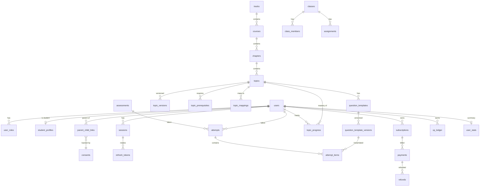

# MathPath: Database Schema

|         |                                                            |
| ------- | ---------------------------------------------------------- |
| Status  | Draft for approval (Phase 3)                               |
| Version | 0.1.0                                                      |
| Date    | 2026-11-15                                                 |
| Engine  | PostgreSQL 16+ ([ADR-0004](adr/0004-postgresql-kysely.md)) |

This is the logical schema for the MVP. In Phase 6 it becomes Kysely migrations
in `packages/db/migrations`, each with an `up` and a `down`.

---

## 1. Conventions

| Rule                                                                                                                                                                                     | Why                                                                                  |
| ---------------------------------------------------------------------------------------------------------------------------------------------------------------------------------------- | ------------------------------------------------------------------------------------ |
| Table names are `snake_case` plural; columns are `snake_case`                                                                                                                            | Postgres convention; no quoting needed                                               |
| Primary key `id uuid` (UUIDv7, generated in the app) unless stated                                                                                                                       | Not enumerable; time-ordered for index locality                                      |
| `created_at`, `updated_at timestamptz NOT NULL DEFAULT now()` on mutable tables                                                                                                          | Debugging and auditing                                                               |
| Money: `bigint` in **tiyin** + `currency char(3)`                                                                                                                                        | No float rounding                                                                    |
| Translatable text: `jsonb` "localised object" `{"uz-Latn": "...", "ru": "...", "en": "..."}`                                                                                             | Content locales vary per item; a translation table per entity would triple the joins |
| Enums: `text` + `CHECK` constraint (not Postgres `ENUM`)                                                                                                                                 | Adding a value is a simple migration; Postgres enums cannot drop values              |
| Soft delete only where legally needed (`users.deleted_at` during the grace period); otherwise hard delete                                                                                | Data minimisation                                                                    |
| Phone numbers in E.164 (`+998XXXXXXXXX`)                                                                                                                                                 | One canonical form, so "one account per number" holds                                |
| Secrets (TOTP seeds, provider tokens) encrypted at the application level (AES-256-GCM, key from the secret manager) in `bytea` columns                                                   | A database dump alone leaks nothing usable                                           |
| Tokens, OTPs, PINs: stored only as hashes                                                                                                                                                | Same reason                                                                          |
| Large append-only tables are partitioned **by month** on `created_at`                                                                                                                    | Fast retention drops, smaller indexes                                                |
| Each module owns its tables; there are no cross-module foreign keys to tables of modules that may be extracted later (billing, media). The relationship is kept as a plain `uuid` column | Lets a module become a service later ([ADR-0002](adr/0002-modular-monolith.md))      |

Legend for the tables below: **PK** primary key, **FK** foreign key,
**UQ** unique, **IX** index, _(enc)_ encrypted at the application level.

---

## 2. Overview ERD (core relationships)



---

## 3. Tables by module

### 3.1 `identity`

**users**: one row per person, for every role.
| Column | Type | Notes |
|---|---|---|
| id | uuid PK | |
| phone_e164 | text UQ NULL | NULL for children. A partial unique index applies where `deleted_at IS NULL` |
| phone_verified_at | timestamptz NULL | |
| email | text UQ NULL, CHECK lower-case | Optional; staff only in the MVP. Stored lower-case instead of using the `citext` extension |
| password_hash | text NULL | Argon2id PHC string; NULL for children |
| first_name | text NOT NULL | |
| last_name | text NULL | Never shown on leaderboards; NULL allowed for children |
| locale | text NOT NULL DEFAULT 'uz-Latn' | CHECK in (`uz-Latn`,`ru`,`en`) |
| status | text NOT NULL | CHECK in (`active`,`locked`,`suspended`,`pending_deletion`) |
| risk_level | text NOT NULL DEFAULT 'normal' | CHECK in (`normal`,`elevated`,`high`,`blocked`). This is a cached summary; the details are in `risk_events` |
| last_login_at | timestamptz NULL | |
| deleted_at | timestamptz NULL | Start of the deletion grace period |
| created_at, updated_at | timestamptz | |

**user_roles**
| Column | Type | Notes |
|---|---|---|
| user_id | uuid FK → users | PK (user_id, role) |
| role | text | CHECK in (`student`,`parent`,`teacher`,`author`,`reviewer`,`admin`,`support`) |
| granted_by | uuid FK → users NULL | |
| granted_at | timestamptz | |

Permissions per role live in code (`identity/permissions.ts`), because they
change only together with the code that checks them.

**student_profiles**
| Column | Type | Notes |
|---|---|---|
| user_id | uuid PK FK → users | |
| nickname | text NOT NULL | Shown on leaderboards; moderated |
| nickname_status | text | CHECK in (`pending`,`approved`,`rejected`) |
| grade | smallint NOT NULL | CHECK 1–11 |
| birth_year | smallint NULL | Year only (minimisation) |
| avatar_code | text NULL | Choice from a built-in set; no photo uploads |
| pin_hash | text NOT NULL | Argon2id |
| pin_failed_count | smallint DEFAULT 0 | Locks after N failures (config) |
| pin_locked_until | timestamptz NULL | |
| daily_time_limit_min | smallint NULL | Set by the parent |

**family_codes**: one per parent. A child signs in on a new device with their
parent's family code, then picks their nickname and enters their PIN (UX flow F2).
| Column | Type | Notes |
|---|---|---|
| parent_id | uuid PK FK → users | |
| code | text UQ | 6–8 characters, A–Z and 0–9 |
| created_at | timestamptz | |

**mfa_factors**
| Column | Type | Notes |
|---|---|---|
| id | uuid PK | |
| user*id | uuid FK → users | IX |
| type | text | CHECK in (`totp`) (WebAuthn later) |
| secret | bytea *(enc)\_ | |
| confirmed_at | timestamptz NULL | |
| last_used_step | bigint NULL | Prevents the same TOTP code from being used twice |

**mfa_recovery_codes**: `id`, `user_id` FK, `code_hash`, `used_at`.

**devices**
| Column | Type | Notes |
|---|---|---|
| id | uuid PK | |
| fingerprint_hash | text UQ | HMAC of the client fingerprint (we keep no raw fingerprint) |
| first_seen_at, last_seen_at | timestamptz | |
| trial_used_at | timestamptz NULL | One free trial per device |
| flags | text[] DEFAULT '{}' | For example `emulator`, `headless` |

**sessions**
| Column | Type | Notes |
|---|---|---|
| id | uuid PK | Also the `sid` claim in the access token |
| user_id | uuid FK → users | IX (user_id, revoked_at) |
| device_id | uuid FK → devices NULL | |
| ip_prefix | inet NULL | /24 (IPv4) or /48 (IPv6), not the full IP |
| user_agent_summary | text NULL | Browser + OS family only |
| mfa_verified | boolean DEFAULT false | |
| created_at, last_seen_at | timestamptz | |
| revoked_at | timestamptz NULL | |
| revoke_reason | text NULL | `logout`, `token_reuse`, `admin`, `session_limit`, `password_change` |

**refresh_tokens**
| Column | Type | Notes |
|---|---|---|
| id | uuid PK | |
| session_id | uuid FK → sessions | IX |
| token_hash | bytea UQ | SHA-256 of the opaque token |
| family_id | uuid | All rotations of one login. Reuse of an old token revokes the whole family |
| replaced_by | uuid NULL | |
| expires_at | timestamptz | |
| used_at | timestamptz NULL | |

**otp_challenges**
| Column | Type | Notes |
|---|---|---|
| id | uuid PK | |
| phone_e164 | text | IX (phone_e164, created_at) |
| purpose | text | CHECK in (`signup`,`login`,`reset_password`,`change_phone`) |
| code_hash | text | HMAC-SHA-256 with a server key |
| attempts | smallint DEFAULT 0 | Max from config |
| expires_at | timestamptz | |
| consumed_at | timestamptz NULL | |
| ip_prefix | inet, device_id uuid NULL | For per-IP and per-device limits |
| provider_message_id | text NULL | For SMS spend reconciliation |

The rate-limit counters themselves live in Redis. This table is the durable
record, kept for 30 days.

### 3.2 `family` and `privacy`

**consents**
| Column | Type | Notes |
|---|---|---|
| id | uuid PK | |
| parent_id | uuid FK → users | |
| child_id | uuid FK → users | |
| policy_version | text NOT NULL | For example `privacy-2026-11` |
| scopes | text[] NOT NULL | For example `{learning,leaderboard,teacher_sharing}` |
| method | text | `otp_confirmed` (the parent re-enters an OTP) |
| granted_at | timestamptz | |
| revoked_at | timestamptz NULL | |
| evidence | jsonb | IP prefix, user agent, text hash of the shown policy |

**parent_child_links**: PK (`parent_id`, `child_id`), `consent_id` FK,
`relationship` (`parent`,`guardian`), `created_at`. A child may have up to
two linked parents (config).

**data_requests**
| Column | Type | Notes |
|---|---|---|
| id | uuid PK | |
| user_id | uuid FK | The subject (parent or child) |
| requested_by | uuid FK | |
| type | text | CHECK in (`export`,`deletion`) |
| status | text | `pending`,`processing`,`ready`,`completed`,`cancelled` |
| scheduled_for | timestamptz NULL | Deletion grace end (default 14 days) |
| result_key | text NULL | Object-storage key of the export file (expires after 7 days) |
| created_at, completed_at | timestamptz | |

### 3.3 `risk`

**risk_events** (partitioning deferred, see §5)
| Column | Type | Notes |
|---|---|---|
| id | uuid | PK (id, created_at) |
| user_id | uuid NULL, device_id uuid NULL, ip_prefix inet NULL | At least one is present |
| type | text | For example `otp_velocity`, `datacenter_ip`, `disposable_email`, `fast_answers`, `identical_answers`, `new_device_login`, `token_reuse` |
| score_delta | smallint | Weight from `config/risk.yaml` |
| details | jsonb | No personal data beyond the IDs above |
| created_at | timestamptz | |

**risk_reviews**: `id`, `subject_user_id`, `reason`, `status`
(`open`,`cleared`,`restricted`,`banned`), `reviewer_id`, `notes`, `created_at`,
`decided_at`.

**blocked_prefixes**: `prefix text PK` (for example a premium-rate range),
`reason`, `created_by`, `created_at`. Admins can edit these at runtime without a
deploy.

### 3.4 `catalogue` and `content`

The structure (track/course/chapter/topic) changes rarely, so these are plain
tables. **Lesson content and questions are versioned documents.**

**tracks**: `id`, `slug UQ` (`school`, `international`, `olympiad`,
`entrance`), `title jsonb`, `sort smallint`, `is_active`.

**courses**
| Column | Type | Notes |
|---|---|---|
| id | uuid PK | |
| track_id | uuid FK → tracks | |
| slug | text | UQ (track_id, slug), for example `grade-5`, `presidential-entrance` |
| grade | smallint NULL | Set for school courses |
| title, description | jsonb | Localised |
| status | text | `draft`,`published`,`archived` |
| sort | smallint | |

**chapters**: `id`, `course_id` FK, `slug`, `title jsonb`, `sort`, `status`;
UQ (course_id, slug).

**topics**
| Column | Type | Notes |
|---|---|---|
| id | uuid PK | |
| chapter_id | uuid FK → chapters | IX |
| slug | text | UQ (chapter_id, slug) |
| sort | smallint | |
| is_free | boolean DEFAULT false | The first topic of each chapter is free (set by an author, defaulted from config) |
| published_version_id | uuid NULL FK → topic_versions | The version new learners get |
| created_at, updated_at | | |

**topic_versions**
| Column | Type | Notes |
|---|---|---|
| id | uuid PK | |
| topic_id | uuid FK → topics | UQ (topic_id, version_no) |
| version_no | integer | |
| status | text | `draft` → `in_review` → `approved` → `published` → `archived`; `changes_requested` returns to the author |
| title, summary | jsonb | Localised |
| steps | jsonb | Ordered lesson steps (see §4.1) |
| question_pool | jsonb | Which template versions are used for practice, mastery and review, with counts |
| author_id | uuid FK → users | |
| published_at | timestamptz NULL | |
| content_hash | text | SHA-256 of the canonical JSON. Published versions are **immutable**, enforced by a trigger |

A partial unique index allows **one open version per topic** (`draft`, `in_review`,
`changes_requested` or `approved`), so two authors cannot publish over each other.

**topic_prerequisites** (knowledge graph)
| Column | Type | Notes |
|---|---|---|
| topic_id | uuid FK → topics | PK (topic_id, prerequisite_id) |
| prerequisite_id | uuid FK → topics | Edges may cross courses and tracks |
| strength | text | `required` or `helpful` (only `required` drives gap routing) |

A CHECK prevents self-edges, and the CMS refuses to save an edge that would create a
cycle (checked with a recursive CTE).

**topic_mappings**: `topic_id`, `mapped_topic_id`, `relation`
(`equivalent`,`partial`,`extends`); PK (topic_id, mapped_topic_id). Used to
map school topics ↔ Cambridge/SAT/entrance topics.

**question_templates**: `id`, `topic_id` FK, `external_ref text NULL`
(the author's own label), `created_by`, `created_at`, `published_version_id`.

**question_template_versions**
| Column | Type | Notes |
|---|---|---|
| id | uuid PK | |
| template_id | uuid FK | UQ (template_id, version_no) |
| version_no | integer | |
| status | text | Same workflow as topic versions |
| type | text | CHECK in (`single_choice`,`multiple_choice`,`numeric`,`formula`,`matching`,`ordering`) (more later) |
| difficulty | smallint | 1–5 |
| skills | text[] | Optional tags, for example `{fraction_addition}` |
| body | jsonb | Variables, constraints, stem, answer rule, hints, solution (see §4.2). **Never sent to clients** |
| author_id | uuid | |
| content_hash | text | |
| published_at | timestamptz NULL | |

**content_reviews**
| Column | Type | Notes |
|---|---|---|
| id | uuid PK | |
| entity_type | text | `topic_version`, `question_template_version` |
| entity_id | uuid | IX (entity_type, entity_id) |
| reviewer_id | uuid FK → users | Must differ from the author (CHECK in service + test) |
| decision | text | `approved`, `changes_requested` |
| comments | jsonb | Inline comments anchored to a step or field |
| created_at | timestamptz | |

### 3.5 `media`

**media_assets** (migration `2026111602_media`)
| Column | Type | Notes |
|---|---|---|
| id | uuid PK | |
| kind | text | `video`, `image`, `subtitle` |
| locale | text NULL | Subtitles (required) and videos |
| parent_id | uuid NULL FK → media_assets | The video a subtitle belongs to; only subtitles have one (CHECK) |
| content_type | text | Declared at upload; checked against the stored object |
| size_bytes | bigint | Declared at upload; signed into the upload URL |
| source_key | text UNIQUE | Original upload in the private bucket (`sources/{id}`) |
| status | text | `awaiting_upload`, `uploaded`, `processing`, `ready`, `failed` |
| hls_manifest_key | text NULL | `hls/{id}/master.m3u8`; a ready video must have it and a duration (CHECK) |
| duration_s | integer NULL | |
| renditions | jsonb NULL | `[{name, height, bandwidth}]`; `height` is null for the audio-only fallback |
| error | text NULL | Why an upload or transcode was refused |
| uploaded_by | uuid FK → users | |
| created_at, updated_at | | |

The `key_ref` column planned earlier is not needed: the key row is found by `media_id`.

**media_keys**: `media_id PK FK`, `sealed_key bytea` (44 bytes: IV + GCM tag +
key), `iv bytea` (16 bytes, the HLS IV, not secret), `created_at`,
`rotated_at`. The AES-128 key of each video is sealed with AES-256-GCM under
a key derived from `MEDIA_KEY_SECRET`, with the media ID as associated data,
so neither a database dump nor a copied row decrypts a video. Re-transcoding
a video replaces its key and sets `rotated_at`.

### 3.6 `learning`

**enrolments**: PK (`user_id`, `course_id`), `source`
(`self`,`diagnostic`,`assignment`), `started_at`, `completed_at NULL`.

**topic_progress**
| Column | Type | Notes |
|---|---|---|
| user_id | uuid FK | PK (user_id, topic_id) |
| topic_id | uuid FK | |
| topic_version_id | uuid FK | Pinned until the topic is completed |
| state | text | `not_started`,`learning`,`mastered`,`needs_review` |
| mastery | numeric(4,3) | 0.000–1.000, the latest estimate |
| steps_completed | smallint[] | Indexes of completed lesson steps |
| mastered_at | timestamptz NULL | |
| next_review_at | timestamptz NULL | IX for the review queue |
| review_interval_days | smallint NULL | SM-2 state |
| ease | numeric(3,2) NULL | SM-2 state |
| review_count | smallint DEFAULT 0 | |
| updated_at | timestamptz | |

**learning_paths**: `id`, `user_id`, `course_id`, `generated_from_attempt_id NULL`,
`items jsonb` (ordered topic IDs with a reason code), `created_at`. Only the
latest path per (user, course) is current (`is_current boolean`, partial UQ).

**learning_events** (partitioned monthly; analytics and adaptivity audit)
| Column | Type | Notes |
|---|---|---|
| id | uuid | PK (id, created_at) |
| user_id | uuid | |
| type | text | For example `step_completed`, `gap_routed`, `review_due`, `path_regenerated` |
| topic_id | uuid NULL | |
| payload | jsonb | For example `{fromTopic, toTopic, rule, mastery}` for `gap_routed` |
| created_at | timestamptz | |

> **Implementation note (step 6.4c, migration `2026111702_learning`):**
> `topic_progress` is built as above except `topic_version_id` (topics are not
> versioned per learner yet); `ease` is checked between 1.30 and 3.00 and the
> review queue uses a partial index on `(user_id, next_review_at)`.
> `learning_paths` is **not** stored: the path is computed on read from
> `topic_progress` and the prerequisite graph (due reviews first, then a
> topological order without mastered topics), because it changes after every
> attempt and a stored copy would go stale. A new table, **learning_detours**
> (`from_topic_id`, `to_topic_id`, `depth ≥ 1`, `status` open / refreshed /
> added_to_path / closed, `resolved_at` set exactly when not open), records the
> gap router's open detours so a review knows it is a gap check and the daily
> and depth limits can be counted. `learning_events` starts as a plain table
> with a type check; partitioning comes with the retention job. `attempts`
> gains `recommendation jsonb`, the stored output of the gap router. A trigger
> on `topic_prerequisites` refuses an edge that would create a cycle, so the
> graph stays a DAG whichever tool writes it.

### 3.7 `assessment`

**assessments**: a reusable definition of a test.
| Column | Type | Notes |
|---|---|---|
| id | uuid PK | |
| type | text | `diagnostic`,`practice`,`mastery`,`review`,`chapter`,`mock_exam` |
| scope_type | text | `topic`,`chapter`,`course` |
| scope_id | uuid | |
| blueprint | jsonb | Item counts by topic and difficulty, time limit, feedback policy, pass threshold override |
| version_no | integer | |
| status | text | `draft`,`published`,`archived` |

**attempts**
| Column | Type | Notes |
|---|---|---|
| id | uuid PK | |
| user_id | uuid FK | IX (user_id, created_at) |
| assessment_id | uuid FK | |
| assignment_id | uuid NULL | When started from a teacher assignment |
| status | text | `in_progress`,`submitted`,`expired`,`invalidated` |
| started_at | timestamptz | |
| deadline_at | timestamptz NULL | For timed tests (enforced by the server) |
| submitted_at | timestamptz NULL | |
| score, max_score | numeric(7,2) NULL | |
| passed | boolean NULL | |
| integrity_flags | text[] DEFAULT '{}' | For example `{too_fast}`; set by the anti-cheat job |
| idempotency_key | text NULL | UQ (user_id, idempotency_key) |

**attempt_items** (partitioned monthly by `created_at`)
| Column | Type | Notes |
|---|---|---|
| id | uuid | PK (id, created_at) |
| attempt_id | uuid | IX (attempt_id, position) |
| position | smallint | |
| template_version_id | uuid | |
| params | jsonb | The generated variable values |
| answer_key | jsonb | **Server-only** |
| presented | jsonb | What the client was shown (stem, choices in their shuffled order) |
| response | jsonb NULL | |
| is_correct | boolean NULL | |
| score | numeric(5,2) NULL | |
| tries | smallint DEFAULT 0 | |
| hints_shown | smallint DEFAULT 0 | |
| served_at, answered_at | timestamptz | Server-measured time to answer |
| created_at | timestamptz | |

**daily_usage**: PK (`user_id`, `day date`), `exercises_count`,
`minutes_active`. Enforces the free-tier daily limit and the parent's time limit.
Hot counters live in Redis and are flushed here.

> **Implementation note (step 6.4b, migration `2026111701_assessment`):**
>
> - `assessments` rows for topic practice and mastery are created on first use;
>   an empty `blueprint` means "use config/learning.yaml", so a config change
>   applies without rewriting rows.
> - `attempts` adds `topic_id` (for the topic status query) and a partial
>   unique index: one `in_progress` attempt per learner and assessment, so a
>   second start resumes the open one.
> - `attempt_items` adds `seed`, `feedback` (hints and solution for this
>   item's numbers, server-only like `answer_key`), and `last_request_key` /
>   `last_result` so a retried answer with the same Idempotency-Key is not
>   counted twice. It starts as a plain table, like `audit_log`.
> - `daily_usage` is updated directly in PostgreSQL with a conditional
>   upsert (`exercises_count < limit`), which is atomic; Redis counters can
>   come later if this becomes hot. Days are Tashkent days (UTC+5).

### 3.8 `gamification`

**xp_ledger** (partitioned monthly)
| Column | Type | Notes |
|---|---|---|
| id | uuid | PK (id, created_at) |
| user_id | uuid | IX |
| amount | integer | Positive or, for admin corrections, negative |
| reason | text | `first_try_correct`, `mastery_passed`, `review_passed`, `quest_completed`, `admin_adjustment` |
| source_type, source_id | text, uuid | UQ (user_id, reason, source_type, source_id): **XP cannot be awarded twice for the same thing** |
| created_at | timestamptz | |

**user_stats**: `user_id PK`, `xp_total`, `level`, `current_streak`,
`longest_streak`, `last_active_day date`, `streak_freezes smallint`,
`updated_at`. This is a projection of the ledger and can be rebuilt from it.

**badges**: `id`, `code UQ`, `title jsonb`, `description jsonb`,
`icon_key`, `criteria jsonb` (evaluated by the gamification module).
**user_badges**: PK (`user_id`, `badge_id`), `awarded_at`.

**quests**: `id`, `code`, `day date`, `definition jsonb`; UQ (code, day).
**user_quests**: PK (`user_id`, `quest_id`), `progress`, `completed_at NULL`.

**leagues**: `id`, `week_start date`, `tier smallint`, `cohort smallint`
(groups of ~30, grade-banded so children compete with peers).
**league_members**: PK (`league_id`, `user_id`), `weekly_xp`, `final_rank NULL`.
Live rankings are in Redis sorted sets, and this table holds the result.

### 3.9 `certificates`

**certificates**
| Column | Type | Notes |
|---|---|---|
| id | uuid PK | |
| serial | text UQ | Short, human-friendly, non-sequential (for example `MP-7K3Q-9XFD`) |
| user_id | uuid FK | |
| course_id | uuid FK | |
| display_name | text | First name + last initial, copied at issue time |
| issued_at | timestamptz | |
| signature | bytea | Ed25519 signature over (serial, course, name, date) |
| pdf_key | text | Object storage |
| revoked_at | timestamptz NULL | |

### 3.10 `billing`

Plans and prices live in `config/billing.yaml`. The tables store **snapshots**,
so a later price change never alters an existing order.

**subscriptions**
| Column | Type | Notes |
|---|---|---|
| id | uuid PK | |
| owner_id | uuid | Parent who pays. IX |
| plan_code | text | For example `family_annual` |
| status | text | `trialing`,`active`,`past_due`,`cancelled`,`expired` |
| seats | smallint | Number of children covered |
| price_tiyin | bigint | Snapshot |
| current_period_start, current_period_end | timestamptz | |
| cancel_at_period_end | boolean DEFAULT false | |
| payment_method_id | uuid NULL | For auto-renewal |
| created_at, updated_at | | |

**subscription_members**: PK (`subscription_id`, `student_id`). These are the
children covered.

**payment_methods**
| Column | Type | Notes |
|---|---|---|
| id | uuid PK | |
| owner*id | uuid | |
| provider | text | `payme`, `click` (later `uzum`, `uzcard`, `humo`, `stripe`...) |
| provider_token | bytea *(enc)\_ | **Only** the provider's token |
| card_mask | text | For example `8600 **** **** 1234` |
| card_expiry | text | `MM/YY` |
| card_fingerprint | text NULL | Provider-issued or HMAC of the token-bound ID; IX; one trial per card |
| status | text | `active`,`removed`,`expired` |

**orders**: one intended purchase.
| Column | Type | Notes |
|---|---|---|
| id | uuid PK | Also the account ID sent to the provider |
| owner_id | uuid | |
| plan_code | text | |
| amount_tiyin | bigint | After the discount |
| discount_tiyin | bigint DEFAULT 0 | |
| promo_code_id | uuid NULL | |
| status | text | `created`,`pending`,`paid`,`cancelled`,`expired` |
| idempotency_key | text | UQ (owner_id, idempotency_key) |
| expires_at | timestamptz | |

**payments**
| Column | Type | Notes |
|---|---|---|
| id | uuid PK | |
| order_id | uuid FK → orders | |
| subscription_id | uuid NULL | |
| provider | text | |
| provider_txn_id | text | **UQ (provider, provider_txn_id)** |
| amount_tiyin | bigint | |
| status | text | `pending`,`paid`,`cancelled`,`refunded`,`partially_refunded`,`failed`. Forward-only transitions (DB trigger) |
| fiscal_receipt | jsonb NULL | Fiscal data returned by or sent to the provider |
| provider_created_at, paid_at, cancelled_at | timestamptz | |
| cancel_reason | text NULL | |

**refunds**: `id`, `payment_id` FK, `amount_tiyin`, `status`
(`requested`,`succeeded`,`failed`), `reason`, `requested_by` (admin),
`provider_ref`, `created_at`.

**payment_callbacks**: a raw log of every provider call.
| Column | Type | Notes |
|---|---|---|
| id | uuid PK | |
| provider | text | |
| method | text | For example `CreateTransaction`, `prepare`, `complete` |
| external_id | text NULL | |
| auth_valid | boolean | Result of signature or credential verification |
| payload | jsonb | Personal data stripped |
| response | jsonb | What we answered, so repeats get the same answer |
| received_at | timestamptz | |

**promo_codes**: `id`, `code citext UQ`, `discount_type`
(`percent`,`fixed`), `value`, `plan_codes text[] NULL`, `max_redemptions`,
`per_user_limit`, `valid_from`, `valid_to`, `is_active`, `created_by`.
**promo_redemptions**: PK (`promo_code_id`, `order_id`), `owner_id`, `created_at`.

**trials**: `id`, `owner_id` UQ, `device_id` UQ, `card_fingerprint` UQ NULL,
`started_at`, `ends_at`. The unique constraints enforce "one trial per
account, device and card" in the database itself.

**referrals**: `id`, `referrer_id`, `referred_id UQ`, `code`, `status`
(`pending`,`qualified`,`rewarded`,`rejected`), `qualified_at`, `reward_ref`.
The reward is granted only after the referred account is verified and active
for N days (config).

### 3.11 `classroom`

**classes**: `id`, `teacher_id`, `name`, `grade`, `join_code UQ`
(rotatable), `is_archived`, `created_at`.
**class_members**: PK (`class_id`, `student_id`), `joined_at`,
`parent_approved_at NULL` (a parent must approve sharing with a teacher, which is
the `teacher_sharing` consent scope).
**assignments**: `id`, `class_id`, `assessment_id NULL`, `topic_id NULL`,
`title`, `due_at`, `created_at`. CHECK that exactly one target is set.

### 3.12 `notifications`

**notifications**: `id`, `user_id`, `channel` (`sms`,`email`,`in_app`),
`template_code`, `params jsonb`, `status`, `scheduled_for`, `sent_at`,
`provider_message_id`. The quiet-hours rule from config is applied at
scheduling time.

### 3.13 Platform tables

**outbox_events** ([ADR-0007](adr/0007-outbox-domain-events.md)):
`id`, `aggregate_type`, `aggregate_id`, `event_type`, `payload jsonb`,
`created_at`, `published_at NULL`. IX on (`published_at`) WHERE `published_at IS NULL`.

**processed_events**: PK (`event_id`, `handler`), `processed_at`. This makes
consumers idempotent.

**idempotency_keys**: PK (`scope`, `key`), `request_hash`,
`response_status`, `response_body jsonb`, `created_at`. Kept for 24 hours.
Used for POSTs that carry an `Idempotency-Key`.

**audit_log** (**append-only**; partitioning deferred, see §5)
| Column | Type | Notes |
|---|---|---|
| id | uuid | PK (id, created_at) |
| actor_id | uuid NULL | NULL for the system |
| actor_roles | text[] | |
| action | text | For example `user.role.grant`, `payment.refund`, `content.publish`, `consent.revoke` |
| target_type, target_id | text, uuid | |
| ip_prefix | inet NULL | |
| request_id | text | |
| metadata | jsonb | |
| prev_hash, hash | bytea | Hash chain makes tampering detectable |
| created_at | timestamptz | |

The application DB role has `INSERT` and `SELECT` only. Retention is 3 years,
or whatever the lawyer review sets.

---

## 4. JSON document shapes

These shapes are validated with Zod schemas in `packages/question-engine` and
`packages/contracts`.

### 4.1 `topic_versions.steps`

```json
[
  { "type": "video", "mediaId": "0193...", "durationS": 412, "required": true },
  {
    "type": "activity",
    "activity": "number_line",
    "config": { "min": 0, "max": 1, "ticks": 8 },
    "prompt": { "uz-Latn": "...", "ru": "..." }
  },
  { "type": "practice", "pool": "practice", "minCorrect": 6 },
  { "type": "mastery_test", "assessmentId": "0193..." },
  { "type": "review", "pool": "review" }
]
```

### 4.2 `question_template_versions.body` (example: fraction addition)

```json
{
  "variables": {
    "d": { "int": [2, 9] },
    "a": { "int": [1, "d-1"] },
    "b": { "int": [1, "d-1"] }
  },
  "constraints": ["a + b != d"],
  "stem": {
    "uz-Latn": "Hisoblang: $\\frac{{a}}{{d}} + \\frac{{b}}{{d}}$",
    "ru": "Вычислите: $\\frac{{a}}{{d}} + \\frac{{b}}{{d}}$"
  },
  "answer": {
    "kind": "fraction",
    "expr": "(a+b)/d",
    "accept": ["equivalent", "mixed_number"],
    "requireSimplified": false
  },
  "hints": [{ "uz-Latn": "Maxrajlar bir xil...", "ru": "Знаменатели одинаковые..." }],
  "solution": { "uz-Latn": "...", "ru": "..." },
  "distractors": ["(a+b)/(2*d)", "(a*b)/d"]
}
```

Expressions are evaluated by the **sandboxed expression engine** in
`@mathpath/questions` (ADR-0011): exact fractions, a fixed grammar and a fixed
function list (`abs`, `floor`, `ceil`, `round`, `min`, `max`, `gcd`, `lcm`,
`mod`, `numerator`, `denominator`). There is no `eval`, and authors can't run
arbitrary code. Variables may read each other in any order the author writes
them; the engine sorts them by what they read (jsonb does not keep key order).
`{expression}` in a text is replaced by its value, so `\\frac{{a}}{{d}}` becomes
`\\frac{3}{7}`.

Answer kinds: `number` (`expr`, optional `decimals` for values that do not end),
`fraction` (`expr`, `accept`: `equivalent` / `mixed_number` / `decimal`,
`requireSimplified`), `choice` (a generated single choice from `expr` and
`distractors`) and `choices` (listed options with `correct`). The engine
generates `numeric`, `single_choice` and `multiple_choice` today.

---

## 5. Indexing, partitioning and retention

| Table          | Hot query          | Index                                              |
| -------------- | ------------------ | -------------------------------------------------- |
| users          | Login by phone     | Partial UQ `(phone_e164) WHERE deleted_at IS NULL` |
| topic_progress | Review queue       | `(user_id, next_review_at)`                        |
| attempt_items  | Load an attempt    | `(attempt_id, position)`                           |
| attempts       | Recent attempts    | `(user_id, created_at DESC)`                       |
| xp_ledger      | Weekly XP          | `(user_id, created_at)`                            |
| outbox_events  | Unpublished events | Partial `(created_at) WHERE published_at IS NULL`  |
| sessions       | Active sessions    | `(user_id) WHERE revoked_at IS NULL`               |

| Partitioned table | Retention (config, pending lawyer review)                                     |
| ----------------- | ----------------------------------------------------------------------------- |
| attempt_items     | Lifetime of the account (needed for analytics), then deleted with the account |
| learning_events   | 24 months, then aggregated                                                    |
| risk_events       | 12 months                                                                     |
| xp_ledger         | Lifetime of the account                                                       |
| audit_log         | 3 years                                                                       |

Partitions are created ahead of time by a monthly worker job. Old partitions are
dropped or detached in a single operation instead of slow `DELETE`s.

---

> **Implementation note (step 6.2):** `risk_events` and `audit_log` start as plain
> tables with a `created_at` index. Monthly partitioning is added in a later
> migration once volume justifies it (target: before public launch), because
> it needs the partition-maintenance job from the worker.

## 6. Migrations

- Location: `packages/db/migrations/YYYYMMDDHHMM_<description>.ts`, each
  exporting `up(db)` and `down(db)`.
- CI runs **up → down → up** on a throwaway database for every PR.
- Production deploys run migrations as a separate step _before_ the new code
  starts, using the **expand → migrate → contract** pattern: add a nullable
  column, backfill, then remove the old column in a later release. Each deploy
  is then compatible with both the old and new code, and rollback stays possible.
- Seed data (tracks, demo topics, badges) lives in `packages/db/seeds` and is
  idempotent.

---

## 7. Personal data map (for export and deletion)

| Data            | Tables                                                   | On export | On deletion                                                                                |
| --------------- | -------------------------------------------------------- | --------- | ------------------------------------------------------------------------------------------ |
| Identity        | users, student_profiles, user_roles                      | ✅        | Hard-deleted after the grace period                                                        |
| Consent records | consents                                                 | ✅        | Kept (legal evidence), the subject ID is pseudonymised                                     |
| Learning        | topic_progress, attempts, attempt_items, learning_events | ✅        | Deleted; aggregates are kept without the user ID                                           |
| Gamification    | xp_ledger, user_stats, user_badges, league_members       | ✅        | Deleted                                                                                    |
| Billing         | orders, payments, refunds                                | ✅        | **Kept** as required by tax law (retention period to be confirmed); owner ID pseudonymised |
| Security        | sessions, risk_events, audit_log                         | Summary   | Sessions deleted; audit and risk rows pseudonymised                                        |
| Certificates    | certificates                                             | ✅        | Revoked and deleted (the verification page then shows "revoked")                           |

Each module implements `PersonalDataProvider.export(userId)` and
`.erase(userId)`. The `privacy` module calls them all, and a test fails
if a table with a `user_id`-like column is not covered by some provider.
