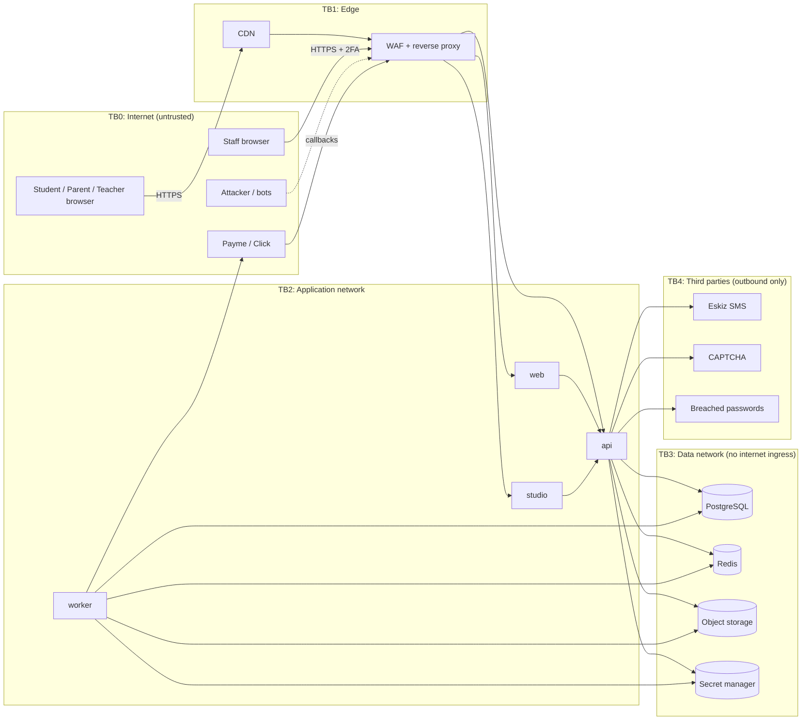

# MathPath: Threat Model (STRIDE)

|         |                                                                                                             |
| ------- | ----------------------------------------------------------------------------------------------------------- |
| Status  | Draft for approval (Phase 4)                                                                                |
| Version | 0.1.0                                                                                                       |
| Date    | 2026-11-15                                                                                                  |
| Method  | STRIDE per element over the data-flow diagram, risk = likelihood × impact                                   |
| Related | [Security plan](security-plan.md) · [Architecture](../architecture.md) · [DB schema](../database-schema.md) |

The threat model is a living document. It is reviewed when a new module,
external integration or trust boundary is added, and before every major release.

---

## 1. Scope and assumptions

**In scope:** the MVP system as designed in Phase 3: `web`, `studio`, `api`,
`worker`, PostgreSQL, Redis, object storage, the CDN/WAF edge, and the
integrations with Eskiz (SMS), Payme, Click, the CAPTCHA provider and the
breached-password API.

**Out of scope for now:** native mobile apps, school licence integrations, and
the physical security of the data centre (covered by the hosting contract).

**Assumptions**

- A1. The hosting provider is in Uzbekistan and provides network isolation,
  encrypted disks and physical security.
- A2. Payment providers (Payme, Click) are trusted for card handling. We never
  see card numbers.
- A3. Students are minors (most MVP users are 10–12), so **children's data
  incidents carry the highest impact rating**, regardless of record count.
- A4. One maintainer at launch. Controls must be automated, because manual
  checks will be skipped under pressure.

---

## 2. Assets

| ID   | Asset                                                                  | Why it matters                                    | Impact if lost |
| ---- | ---------------------------------------------------------------------- | ------------------------------------------------- | -------------- |
| AS1  | Children's personal data (name, nickname, grade, birth year, progress) | Minors; legal duties; parental trust              | **Critical**   |
| AS2  | Parent identity (phone, name, password hash)                           | Account takeover leads to child data and payments | High           |
| AS3  | Consent records                                                        | Legal evidence for processing children's data     | High           |
| AS4  | Session and refresh tokens, staff 2FA                                  | Direct account access                             | High           |
| AS5  | Payment state (orders, payments, provider tokens)                      | Money; fraud; regulatory                          | High           |
| AS6  | Assessment integrity (answer keys, templates, scores)                  | Certificates and leaderboards lose meaning        | Medium–High    |
| AS7  | Content IP (videos, question banks)                                    | Business value; piracy                            | Medium         |
| AS8  | Platform availability                                                  | Exam-season outages hurt trust and revenue        | Medium–High    |
| AS9  | Secrets (DB credentials, signing keys, provider keys, HLS master key)  | Unlock everything else                            | **Critical**   |
| AS10 | Audit log                                                              | Needed to investigate any incident                | High           |
| AS11 | SMS budget                                                             | SMS pumping can drain money quickly               | Medium         |

---

## 3. Actors

| Actor                                                  | Motivation                                         | Capability                                                          |
| ------------------------------------------------------ | -------------------------------------------------- | ------------------------------------------------------------------- |
| Curious student                                        | Cheat on tests, climb the leaderboard, see answers | Browser dev tools, shared answers, scripts copied from the internet |
| Malicious outsider                                     | Steal data, sell accounts, deface                  | Automated scanners, credential stuffing lists, botnets              |
| SMS fraudster                                          | Profit from SMS pumping (premium routes)           | Botnets, proxy networks                                             |
| Payment fraudster                                      | Free subscriptions, stolen cards, refund abuse     | Stolen cards, many accounts                                         |
| Freeloader                                             | Many free trials, account sharing                  | Many phones and devices                                             |
| Content pirate                                         | Resell videos and question banks                   | Screen recording, scraping                                          |
| Malicious or careless insider (author, support, admin) | Curiosity, revenge, mistakes                       | Legitimate access to studio or admin                                |
| Compromised dependency                                 | Supply-chain attack                                | Code running inside our build or runtime                            |
| Predator / abuser                                      | Contact children                                   | Uses any free-text field or social feature                          |

The last actor is why the MVP has **no child-to-child messaging, no free-text
profile fields visible to others, and moderated nicknames.**

---

## 4. Data-flow diagram and trust boundaries

| Boundary        | What crosses it                | Main control                                                     |
| --------------- | ------------------------------ | ---------------------------------------------------------------- |
| TB0 → TB1       | All user and provider traffic  | TLS 1.3, WAF (OWASP CRS), DDoS protection, rate limits           |
| TB1 → TB2       | Filtered HTTP                  | Only the proxy can reach the apps; mTLS or a private network     |
| TB2 → TB3       | Queries, cache, files, secrets | Per-service DB roles, network policy, no public ingress          |
| TB2 → TB4       | Outbound API calls             | Egress allow-list (only known provider hosts), timeouts          |
| Staff ↔ studio | Content and admin actions      | Separate subdomain, mandatory 2FA, optional IP allow-list, audit |

---

## 5. STRIDE analysis

**Rating:** L (likelihood) and I (impact) on 1–3; **Risk = L × I**
(1–2 Low, 3–4 Medium, 6–9 High). The control IDs (C-xx) refer to the
[security plan](security-plan.md).

### 5.1 Identity: sign-up, login, sessions (`identity`, `family`)

| #   | STRIDE | Threat                                                        | L   | I   | Risk  | Mitigations                                                                                                                                                   |
| --- | ------ | ------------------------------------------------------------- | --- | --- | ----- | ------------------------------------------------------------------------------------------------------------------------------------------------------------- |
| T1  | S      | Credential stuffing against parent accounts                   | 3   | 3   | **9** | Login limits per account and IP (C-04), breached-password check (C-02), CAPTCHA escalation (C-21), new-device alerts (C-05)                                   |
| T2  | S      | OTP brute force (guessing a 6-digit code)                     | 2   | 3   | 6     | Max 5 attempts per challenge, 5-minute expiry, per-phone and per-IP limits, HMAC-hashed codes (C-03)                                                          |
| T3  | S      | SIM swap or a stolen phone gives access to the parent account | 1   | 3   | 3     | A password is required on new devices in addition to OTP; alerts on new devices; sensitive actions (deletion, export, payment method change) need a fresh OTP |
| T4  | S      | Child PIN brute force using the family code                   | 2   | 2   | 4     | 4–6 digit PIN, lock after 5 failures, parent notified, family code rate-limited per IP (C-04)                                                                 |
| T5  | S      | Stolen refresh token reused                                   | 2   | 3   | 6     | Rotation with reuse detection that revokes the whole family (C-06), HttpOnly cookies (C-07)                                                                   |
| T6  | S      | Staff account takeover                                        | 2   | 3   | 6     | Mandatory TOTP 2FA (C-08), separate studio domain, session timeout of 8 hours, IP allow-list option                                                           |
| T7  | T      | JWT forgery or algorithm confusion                            | 1   | 3   | 3     | EdDSA only, `alg` pinned on verify, key ID checked, keys in the secret manager (C-06)                                                                         |
| T8  | R      | A parent denies giving consent                                | 2   | 2   | 4     | Consent record with OTP confirmation, policy hash and timestamp (C-30)                                                                                        |
| T9  | I      | Phone enumeration through sign-up or OTP responses            | 3   | 1   | 3     | Identical responses and timing whether or not a number exists (C-03)                                                                                          |
| T10 | D      | SMS pumping: bots request OTPs to premium numbers             | 3   | 2   | 6     | Per-number/IP/device limits, blocked prefixes, country restriction (+998 only in the MVP), daily spend cap with alerts and a circuit breaker (C-20)           |
| T11 | E      | Account sharing beyond the plan                               | 3   | 1   | 3     | Concurrent session and device limits (C-24)                                                                                                                   |
| T12 | E      | Mass registration of fake accounts                            | 3   | 2   | 6     | One account per phone, risk scoring, datacenter/VPN IP signals, velocity rules (C-21–C-23)                                                                    |

### 5.2 Authorisation and data access (all modules)

| #   | STRIDE | Threat                                                          | L   | I   | Risk  | Mitigations                                                                                                                                                       |
| --- | ------ | --------------------------------------------------------------- | --- | --- | ----- | ----------------------------------------------------------------------------------------------------------------------------------------------------------------- |
| T13 | E      | IDOR: a parent reads another child's progress by changing an ID | 3   | 3   | **9** | Object-level checks in every handler through a shared `assertCanAccessStudent()` policy (C-10), UUIDv7, automated IDOR tests for every `{studentId}` route (C-41) |
| T14 | E      | A route is missing its permission check                         | 2   | 3   | 6     | A global guard denies by default; a build-time test fails if any route lacks `@Permissions` (C-09)                                                                |
| T15 | E      | Teacher sees students without parental sharing consent          | 2   | 3   | 6     | Class membership becomes active only after `teacher_sharing` consent (C-30)                                                                                       |
| T16 | E      | Mass assignment, for example sending `roles` in `PATCH /me`     | 2   | 3   | 6     | `additionalProperties: false` in every request schema; unknown fields rejected (C-12)                                                                             |
| T17 | I      | Over-exposure in API responses (answer keys, phone numbers)     | 2   | 3   | 6     | Response schemas validated against the contract in tests; serializers allow-list fields (C-12)                                                                    |
| T18 | E      | Insider abuse: support or admin browsing children's data        | 2   | 3   | 6     | Least-privilege roles, every admin read audited, masked phone numbers, quarterly access review (C-14, C-33)                                                       |

### 5.3 Web front-ends (`web`, `studio`)

| #   | STRIDE | Threat                                                    | L   | I   | Risk | Mitigations                                                                                                                                            |
| --- | ------ | --------------------------------------------------------- | --- | --- | ---- | ------------------------------------------------------------------------------------------------------------------------------------------------------ |
| T19 | T      | Stored XSS through author content or nicknames            | 2   | 3   | 6    | No raw HTML from authors (structured documents only), KaTeX in `trust: false` mode, nickname character allow-list, strict CSP with nonces (C-13, C-15) |
| T20 | T      | CSRF on state-changing requests                           | 2   | 2   | 4    | SameSite cookies and a session-bound CSRF token (C-07, ADR-0010)                                                                                       |
| T21 | S      | Clickjacking (for example on the payment or consent page) | 1   | 2   | 2    | `frame-ancestors 'none'` (C-15)                                                                                                                        |
| T22 | T      | Malicious dependency in the front-end bundle              | 2   | 3   | 6    | Lockfile, dependency scanning, Subresource Integrity, minimal dependencies, Renovate with review (C-42)                                                |
| T23 | I      | Tokens or personal data cached on a shared family device  | 2   | 2   | 4    | `Cache-Control: no-store` on personal API responses; the service worker caches only content, never API data containing personal details                |

### 5.4 Assessment and learning (`assessment`, `learning`, `gamification`)

| #   | STRIDE | Threat                                                                   | L   | I   | Risk | Mitigations                                                                                                                          |
| --- | ------ | ------------------------------------------------------------------------ | --- | --- | ---- | ------------------------------------------------------------------------------------------------------------------------------------ |
| T24 | I      | Reading answer keys from the client                                      | 3   | 2   | 6    | Answers never leave the server; `question-engine` cannot be imported by `web` (lint rule) (C-16)                                     |
| T25 | T      | Replaying or tampering with answer requests (resubmitting until correct) | 3   | 2   | 6    | Server-side `tries` limit per item, idempotency keys, attempt state machine (C-16)                                                   |
| T26 | T      | Bots or scripts answering tests very quickly                             | 2   | 2   | 4    | Server-side timing, anomaly job, results flagged for review, not silently awarded (C-25)                                             |
| T27 | T      | Answer sharing between students                                          | 3   | 1   | 3    | Parameterised questions and shuffled choices, so each student gets different numbers (C-16); identical-wrong-answer detection (C-25) |
| T28 | T      | XP farming (repeating easy items)                                        | 3   | 1   | 3    | XP only for first-try correct answers on new items, mastery passes and due reviews; unique ledger constraint; daily XP cap (C-26)    |
| T29 | E      | Sandbox escape through author-written template expressions               | 1   | 3   | 3    | An own expression engine with a fixed grammar and function list (ADR-0011), exact arithmetic, size, depth and time limits (C-17)     |
| T30 | D      | Expensive template (constraint loop that never succeeds)                 | 2   | 1   | 2    | Max generation attempts per item, rejected at preview time                                                                           |

### 5.5 Payments (`billing`)

| #   | STRIDE | Threat                                                      | L   | I   | Risk | Mitigations                                                                                                                                                                                |
| --- | ------ | ----------------------------------------------------------- | --- | --- | ---- | ------------------------------------------------------------------------------------------------------------------------------------------------------------------------------------------ |
| T31 | S      | Forged provider callback marking an order as paid           | 2   | 3   | 6    | Provider authentication verified first (Payme credentials, Click `sign_string`, constant-time comparison), amount and order checked against our DB, optional provider IP allow-list (C-27) |
| T32 | T      | Amount tampering (paying less)                              | 2   | 3   | 6    | The amount comes from the server-side order, never from the client; callbacks with a mismatched amount are rejected (C-27)                                                                 |
| T33 | T      | Double processing of the same payment                       | 2   | 2   | 4    | Unique `(provider, provider_txn_id)`, forward-only state machine, idempotent handlers (C-28)                                                                                               |
| T34 | R      | A customer disputes a charge, or an admin disputes a refund | 2   | 2   | 4    | Raw callback log, audit log for refunds with reason and actor, provider receipts (C-28, C-33)                                                                                              |
| T35 | E      | Trial and referral abuse                                    | 3   | 1   | 3    | One trial per account, device and card (DB unique constraints), referral reward only after verification and N active days (C-23)                                                           |
| T36 | I      | Leak of provider tokens                                     | 1   | 3   | 3    | Tokens encrypted at the application level, keys in the secret manager; tokens are useless without our merchant credentials (C-31)                                                          |
| T37 | E      | Promo code brute force                                      | 2   | 1   | 2    | Rate limits on validation, codes of 8 or more characters, per-user limits                                                                                                                  |

### 5.6 Content and media (`content`, `media`)

| #   | STRIDE | Threat                                            | L   | I   | Risk | Mitigations                                                                                                                                           |
| --- | ------ | ------------------------------------------------- | --- | --- | ---- | ----------------------------------------------------------------------------------------------------------------------------------------------------- |
| T38 | T      | An author publishes harmful or incorrect content  | 2   | 2   | 4    | A reviewer different from the author must approve, publish requires the `content:publish` permission, every version is immutable and audited (C-18)   |
| T39 | T      | Malicious upload (polyglot file, SVG with script) | 2   | 2   | 4    | Content-type allow-list, magic-byte check, size limits, SVG sanitisation, uploads go to a private bucket and are served from a separate domain (C-19) |
| T40 | I      | Video piracy                                      | 3   | 1   | 3    | Encrypted HLS, keys gated by entitlement, signed expiring URLs, dynamic watermark (C-32)                                                              |
| T41 | I      | Scraping the question bank through the API        | 2   | 2   | 4    | Rate limits per user, randomised instances, anomaly alerts on unusual volume                                                                          |
| T42 | E      | SSRF through media URLs or webhooks               | 1   | 3   | 3    | We never fetch user-provided URLs in the MVP. Uploads go directly to storage via presigned URLs, and egress is allow-listed (C-19)                    |

### 5.7 Data stores and infrastructure

| #   | STRIDE | Threat                                              | L   | I   | Risk | Mitigations                                                                                                              |
| --- | ------ | --------------------------------------------------- | --- | --- | ---- | ------------------------------------------------------------------------------------------------------------------------ |
| T43 | I      | SQL injection                                       | 1   | 3   | 3    | Kysely parameterised queries only; `sql.raw` banned by lint; SAST (C-11)                                                 |
| T44 | I      | Backup or disk theft                                | 1   | 3   | 3    | Encryption at rest, encrypted backups with separate keys, application-level encryption for secrets (C-31, C-50)          |
| T45 | I      | Secrets committed to Git or leaked in logs          | 2   | 3   | 6    | Secret scanning in CI and pre-commit, `.env` in `.gitignore`, a log redaction list (C-43, C-34)                          |
| T46 | T      | Audit-log tampering by an insider                   | 1   | 3   | 3    | Append-only DB grants, hash chain, copies to a separate log store (C-33)                                                 |
| T47 | D      | DDoS or traffic spikes during exam season           | 2   | 3   | 6    | DDoS protection at the edge, WAF, rate limits, autoscaling, CDN for static assets, load tests before launch (C-35, C-36) |
| T48 | D      | Ransomware or data loss                             | 1   | 3   | 3    | Backups with point-in-time recovery, offline (immutable) copies, tested restores (C-50)                                  |
| T49 | E      | Container escape or lateral movement                | 1   | 3   | 3    | Non-root distroless images, read-only filesystems, network policies, per-service DB roles (C-37)                         |
| T50 | T      | Compromised CI pipeline publishes a malicious build | 1   | 3   | 3    | Protected `main`, required reviews, pinned GitHub Actions by SHA, minimal CI secrets, signed images (C-44)               |

### 5.8 Privacy and compliance

| #   | STRIDE | Threat                                                                                   | L   | I   | Risk | Mitigations                                                                                                           |
| --- | ------ | ---------------------------------------------------------------------------------------- | --- | --- | ---- | --------------------------------------------------------------------------------------------------------------------- |
| T51 | I      | Children's data stored or processed outside Uzbekistan (logs, error tracking, analytics) | 2   | 3   | 6    | Self-hosted observability in the country; a vendor review gate; no third-party analytics scripts in `web` (C-38)      |
| T52 | I      | A child's full name shown on a leaderboard or certificate page                           | 2   | 2   | 4    | Leaderboards use nicknames only; certificates show first name + last initial; a schema test asserts the fields (C-26) |
| T53 | R      | Inability to prove a deletion happened                                                   | 2   | 2   | 4    | Deletion job writes an audit entry with a per-table count and no personal data (C-30)                                 |
| T54 | I      | Contact with children by strangers                                                       | 1   | 3   | 3    | No messaging, no visible free text, nickname moderation, teacher access only with consent (§3)                        |

---

## 6. Top risks (ordered)

| Rank | Threat                                        | Risk | Why it is top                                                |
| ---- | --------------------------------------------- | ---- | ------------------------------------------------------------ |
| 1    | T13 IDOR on student data                      | 9    | Common in practice, directly exposes children's data         |
| 2    | T1 Credential stuffing                        | 9    | Parents reuse passwords; it leads to child data and payments |
| 3    | T10 SMS pumping                               | 6    | Direct, fast financial loss from the first day               |
| 4    | T31/T32 Payment callback forgery or tampering | 6    | Revenue loss; hard to notice without reconciliation          |
| 5    | T19 Stored XSS through content                | 6    | One payload in published content reaches every student       |
| 6    | T47 DDoS during exam season                   | 6    | Availability at the worst possible time                      |
| 7    | T51 Data leaving the country                  | 6    | Legal exposure; easy to do accidentally with SaaS tools      |

Each of these has an automated test or monitor listed in the
[security plan](security-plan.md) §10, so that a regression fails CI or raises
an alert instead of relying on memory.

---

## 7. Residual risks accepted for the MVP

| Risk                                              | Why accepted                                                                    | Revisit when                                     |
| ------------------------------------------------- | ------------------------------------------------------------------------------- | ------------------------------------------------ |
| Video can still be screen-recorded                | Only DRM plus hardware protection prevents it; the watermark identifies leakers | Before premium video content grows               |
| SIM swap on a parent's phone                      | Mitigated by password + new-device alerts; WebAuthn later                       | When passkey support is common on target devices |
| Device fingerprint can be reset by advanced users | Fingerprint is one signal among several in the risk score                       | When fraud data shows it is a real gap           |
| Answer sharing in the same class in real time     | Parameterisation reduces it; full proctoring is too intrusive for children      | If certificates gain formal value                |
