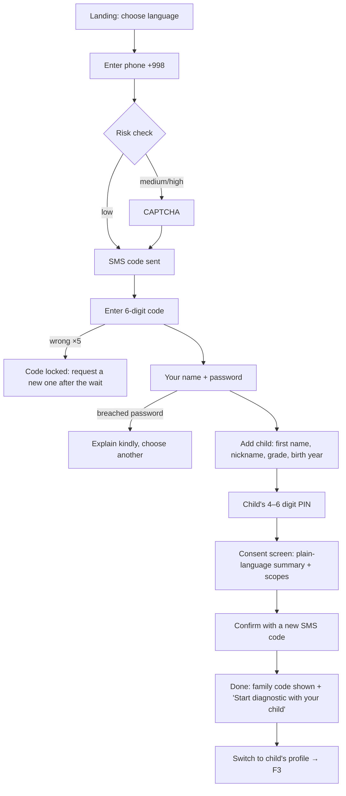
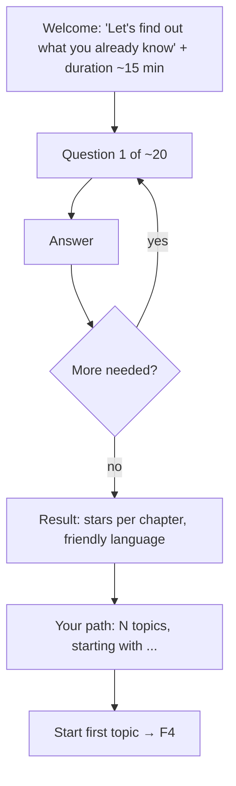
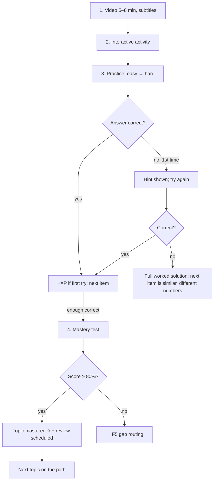
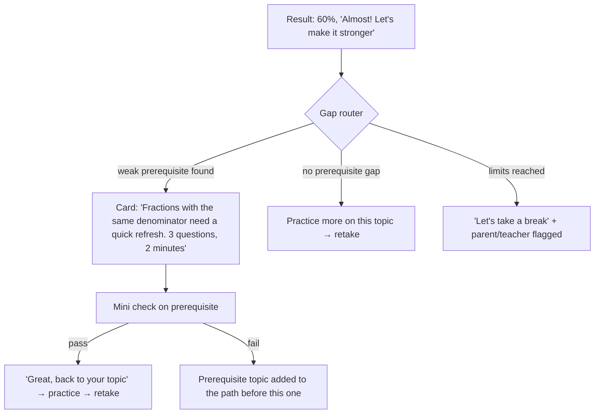
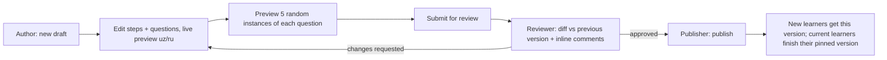

# MathPath: UX Design (key screens and user flows)

|         |                                                                                                                                    |
| ------- | ---------------------------------------------------------------------------------------------------------------------------------- |
| Status  | Draft for approval (Phase 5)                                                                                                       |
| Version | 0.1.0                                                                                                                              |
| Date    | 2026-11-15                                                                                                                         |
| Related | [PRD](../PRD.md) · [API contract](../api/openapi.yaml) · [Clickable wireframes](https://claude.ai/artifact/DrtXXUCgfJRgfRtmCZ5xhS) |

This document defines _how the product behaves_ for each role in the MVP. The
wireframes show _what it looks like_ at low fidelity. Visual design (brand,
illustrations) comes later and must keep the rules in §2 and §8.

---

## 1. Who we design for

| Persona                                                                    | Context                                                                                                        | Design consequence                                                    |
| -------------------------------------------------------------------------- | -------------------------------------------------------------------------------------------------------------- | --------------------------------------------------------------------- |
| **Aziza, 11, grade 5, Samarkand**                                          | Uses her mother's Android phone (5.5", 2–3 GB RAM) after school on mobile data; reads Uzbek well, some Russian | Big targets, short text, works on a shared device, light pages        |
| **Timur, 12, preparing for a Presidential School entrance exam, Tashkent** | Own phone, motivated, wants to see his score improve                                                           | Mock exams, predicted score, clear weak areas                         |
| **Dilnoza, 38, Aziza's mother**                                            | Busy; checks the phone in the evening; pays with Payme                                                         | 30-second weekly summary; payment in three taps; no jargon            |
| **Rustam, 45, school maths teacher**                                       | Laptop at school, phone at home; 30 students                                                                   | Class heat map at a glance; assign in under a minute                  |
| **Malika, methodologist**                                                  | Desktop, writes in Uzbek and Russian                                                                           | Fast editor with live preview of formulas and parameterised questions |

**Devices we test on:** a low-end Android phone (Chrome), an iPhone SE-size
screen (Safari), and a 1366×768 laptop. **Network profiles:** "Slow 3G" and
offline.

---

## 2. UX principles

1. **One screen, one job.** Each screen has exactly one primary button. For
   children, the next step is always the biggest thing on the screen.
2. **Mistakes are part of learning.** A wrong answer shows a calm colour (not red
   alone), an encouraging message and a hint. There are no "Game over", lost hearts
   or punishing sounds.
3. **Short text, big targets.** Touch targets ≥ 48×48 dp; body text ≥ 16 px
   (18 px for students); maximum line length about 60 characters; icons always
   paired with a label.
4. **Show progress, not pressure.** Progress bars and mastery stars, but no
   countdown timers outside timed mock exams, and no "you'll lose your streak!"
   messages.
5. **Light and resilient.** Skeleton screens instead of spinners; every screen has
   an offline state; videos ask before playing above 360p on mobile data.
6. **Same structure in three languages.** Russian text is often 20–30% longer
   than English, and Uzbek can be longer still. Layouts must allow labels to wrap
   to two lines without breaking. A language switcher is on the first screen and
   in settings.
7. **Privacy by default for children.** Nickname, not real name, everywhere
   other children can see; no free-text fields visible to other users.

---

## 3. Information architecture

### 3.1 Student (`web`, bottom navigation, 4 tabs)

| Tab             | Purpose                                      | Contains                                                                |
| --------------- | -------------------------------------------- | ----------------------------------------------------------------------- |
| **Path** (home) | "What do I do next?"                         | Continue card, learning path map, reviews due, today's quest            |
| **Practice**    | Free practice and mock exams                 | Topics by chapter, mock exams (entrance track), reviews                 |
| **League**      | Social motivation (opt-in by parent consent) | Weekly league, badges                                                   |
| **Me**          | Profile and progress                         | Avatar, XP and level, streak, mastery map, certificates, switch profile |

### 3.2 Parent (`web`, bottom navigation)

| Tab          | Contains                                                                                                              |
| ------------ | --------------------------------------------------------------------------------------------------------------------- |
| **Children** | One card per child: this week's minutes, topics mastered, alerts; tap for detail                                      |
| **Reports**  | Weekly report, mastery map, weak areas, predicted score (entrance track)                                              |
| **Plan**     | Current plan, payment method, history and receipts, cancel                                                            |
| **Settings** | Language, children (add or edit, PIN, time limit), consents, privacy (export or delete), security (devices, password) |

### 3.3 Teacher (`web`, top navigation on desktop)

Classes → class (heat map | assignments | students) → student detail
(only with parental consent).

### 3.4 Studio (author, reviewer, admin; desktop-first)

Content tree (track → course → chapter → topic) · Review queue · Media library ·
Admin (users, risk reviews, payments, promo codes, audit log).

---

## 4. User flows

### F1. Parent sign-up, add child, consent (target: under 3 minutes)



**Consent screen rules:** a short summary first (what we store, who sees it, how to
delete it), the full policy one tap away, and each scope as its own toggle:
learning (required), leaderboard (optional, off by default), teacher sharing
(asked later, when a teacher invites).

### F2. Child signs in

- **On the parent's phone:** the Me tab → "Switch profile" → choose the child.
  Switching back to the parent requires the parent's password or OTP, so a
  child can't open billing.
- **On another device:** "I'm a student" → family code → choose the nickname from
  the family's list → PIN pad. After 5 wrong PINs the profile locks and the parent is
  notified.

### F3. Diagnostic → learning path (first session)



There is no right or wrong feedback during the diagnostic (to keep anxiety low).
"I don't know this yet" is a valid answer button, so children don't guess.
A progress bar shows the approximate time left, not the question count, because
the test is adaptive.

### F4. Lesson loop (the core experience)



- Steps appear as a horizontal stepper at the top (5 dots), and the student can go
  back to the video at any time.
- Skipping the video is allowed (some students know the topic). Practice is the
  gate for the mastery test, not the video.
- The mastery test has no hints and shows results only at the end, with a review
  of each item.

### F5. Failed mastery → gap routing



The student always sees **why** they are being sent back, in one sentence, and
they can see where they will return to. A "Retake now" button is available
after the detour, or after a configured cooldown.

### F6. Mock exam (entrance track)

Mock exam list → instructions screen (time, number of questions, rules: no
hints, results at the end) → exam screen with a **visible timer** (the only timed
screen in the product), a question navigator and "flag for review" →
submit (confirmation if questions are unanswered) → results: score, predicted
range (labelled "estimate"), breakdown by section, list of weak topics with a
"Practise this" button for each.

If the connection drops, answers are kept locally and sent when it returns. The
timer is enforced on the server, so a disconnect near the end is handled by
accepting answers that were made before the deadline.

### F7. Subscribe (target: three taps after choosing a plan)

```mermaid
flowchart TD
  A[Paywall card or Plan tab] --> B[Plans: monthly / annual / family, annual pre-selected with the saving shown]
  B --> C[Choose children covered]
  C --> D[Promo code (optional, collapsed)]
  D --> E[Choose Payme or Click]
  E --> F[Provider page: card entry happens there]
  F --> G[Return page: 'Confirming payment…' polls the order]
  G -->|paid| H[Success: what's unlocked + receipt link]
  G -->|cancelled/failed| I[Nothing charged + try again / other provider]
  G -->|timeout 60 s| J['We'll notify you when it completes' (callback may arrive later)]
```

The **paywall shown to a child never asks the child to pay.** It shows "Ask your
parent to unlock this", and the parent gets a notification with a direct link.

### F8. Cancel or request a refund

Plan tab → "Manage plan" → "Turn off auto-renewal" → a confirmation screen that
shows the end date ("Access continues until 15 Dec") → done, with **no dark
patterns** (no guilt messages, no hidden button). Refund requests go through a
"Contact support" form that creates a ticket for an admin.

### F9. Author → review → publish (studio)



### F10. Teacher class

Create class → share the 6-character join code → students join → **the parent
approves sharing** in the app → the student appears in the class → teacher assigns
a topic or test with a due date → heat map shows mastery per student and topic.
Students without consent appear as "Waiting for parent approval" with no data.

### F11. Data export and deletion (parent)

Settings → Privacy → "Download my family's data" (OTP, then a notification when
the file is ready, link valid 7 days) or "Delete account" (explains what is
deleted and what is kept for legal reasons, OTP confirmation, 14-day grace period
with a "Cancel deletion" button and reminder SMS).

### F12. Offline practice

When the connection drops during practice: a small banner "You're offline:
keep practising, we'll check your answers when you're back". Answers are queued
(the item shows "Saved" instead of right or wrong). On reconnect: a summary card
"5 answers checked: 4 correct" and XP. Videos, mastery tests and mock exams show
an offline state with a "Try again" button.

---

## 5. Key screens

Each spec lists the content, the primary action, and the states every screen
must handle: **loading** (skeleton), **empty**, **error**, **offline**.

### S1. Language and welcome (`/`)

- Three large language buttons (O'zbekcha · Русский · English), remembered on the
  device.
- Two paths: "I'm a parent" (primary) and "I'm a student" (secondary), plus
  "I'm a teacher" as a text link.
- **Why parents first:** children under 16 need a parent account, so the parent
  must start.

### S2. Phone and OTP

- Phone field with a fixed `+998` prefix and the number formatted as typed
  (`90 123 45 67`); numeric keyboard.
- OTP: six boxes with auto-advance, `autocomplete="one-time-code"` so Android and
  iOS can fill the code from the SMS; resend timer; "Wrong number?" link.

### S3. Student home: Path

- **Continue card** (largest element): topic name, step progress, "Continue" button.
- **Path map:** a vertical list of topic nodes, done ⭐, current, locked 🔒
  (paid) or "after ..." (prerequisite). Long lists are virtualised.
- **Reviews due** chip ("2 reviews · 3 min"), and **today's quest** (one line).
- Streak and XP are small, in the header, never the main focus.
- Empty state (before diagnostic): one card, "Let's find your starting point".

### S4. Lesson player

- Top: back, 5-step stepper, close.
- **Video step:** 16:9 player, subtitles on by default in the UI language,
  speed control (0.75×–1.5×), quality selector, watermark overlay. Below: one
  "Next: try it yourself" button.
- **Activity step:** full-width interactive area (number line, fraction bars,
  drag-and-drop, step-by-step solver). Each activity can be operated by keyboard
  and screen reader (see §7). "Check" button.
- **Practice step:** see S5.

### S5. Question screen (practice, test, review)

- Stem with KaTeX, max width 60 characters, formula sizes ≥ 18 px.
- Answer area by type:
  - single or multiple choice: full-width option cards (48 dp min height), letters A–D;
  - numeric: big input + **custom number pad** (digits, comma or dot, minus,
    fraction button), because the native keyboard differs across devices;
  - formula: math keyboard with tabs (123 · fractions · x² √ · ( ) =);
  - matching: tap left, then tap right (drag-and-drop optional), for accessibility;
  - ordering: up and down buttons plus drag.
- Footer: "Check" (disabled until answered) · "I don't know" (diagnostic only).
- **Feedback panel** slides up from the bottom:
  - correct: green check + short praise + "+10 XP" (first try only) + "Next";
  - wrong (1st): amber, "Not quite", hint text, "Try again";
  - wrong (2nd): the full worked solution, step by step, "Got it, next".
- Header: item 3/8, practice progress bar, exit.

### S6. Mastery test result

- Large score in a circle, "Mastered! ⭐" or "Almost!" (never "Failed").
- Review list: each item correct or wrong, tap to see the solution.
- Primary action depends on the gap router: "Next topic", "Quick refresh: Fractions",
  or "Practise more".

### S7. Mock exam (timed)

- Sticky header with the timer (turns amber at 5 minutes; announced to screen
  readers at 5 and 1 minute), question navigator grid, flag button.
- Results screen as described in F6.

### S8. League

- The student's position highlighted; about 30 rows with avatar, nickname and weekly
  XP; promotion and demotion zones shown in neutral colours.
- If the parent turned leaderboard consent off: "Leagues are switched off" and
  badges only.
- **No push notifications about rank changes.**

### S9. Me / mastery map

- Avatar, level, XP bar, streak calendar (last 4 weeks).
- **Mastery map:** chapters as rows, topics as cells (colour + icon + text label
  for colour-blind users).
- Certificates list with "Share" (opens the verification link).

### S10. Parent: Children overview

- One card per child: nickname and first name, this week's minutes vs last week,
  topics mastered, a single alert line if needed ("Fractions need practice").
- "Add child" button.

### S11. Parent: Weekly report

Sections: summary in two sentences → time per day (bar chart) → mastered this week
→ needs attention (with "why" and a suggestion) → predicted entrance score
(entrance track, labelled estimate, with confidence) → "Share with teacher" (if
connected). The same content is sent as an SMS with a link and as an in-app
notification on Sunday evening (time in config, never after 21:00).

### S12. Parent: Plan and payment

Current plan, next charge date and amount, card mask, "Change card", payment
history with receipt links, "Turn off auto-renewal". Paywall plans screen as in F7.

### S13. Parent: Settings → Privacy and security

Devices and sessions (sign out a device), change password, consents with toggles
and history, export, delete account.

### S14. Teacher: Class heat map

Desktop: students as rows, topics as columns, cells coloured by mastery with the
value on hover or focus; filters by chapter; "Assign" button. Mobile: a list of
students with mastery bars, because a matrix doesn't fit.

### S15. Studio: Topic editor

Three columns: content tree | step editor (cards for each step; drag to reorder)
| live preview in a phone frame with a locale switcher (uz-Latn / ru).
The question template editor has variables, constraints, stem with a LaTeX
toolbar, answer rule, hints and solution, plus **"Generate 5 samples"** showing
instances and answers, and warnings (for example "Constraint failed in 30% of
seeds").
Status bar: Draft · version 3 · "Submit for review".

### S16. Studio: Review

Side-by-side diff with the previous published version, inline comments,
"Approve" or "Request changes" (the comment is required for changes). The approve
button is disabled for the author's own content.

### S17. Admin: Risk review queue

Table of flagged accounts with the signals that caused the score, account age,
and actions: Clear · Restrict · Ban (reason required). Phone numbers are masked.

---

## 6. Content and tone

| Situation          | Do                                                         | Don't                            |
| ------------------ | ---------------------------------------------------------- | -------------------------------- |
| Wrong answer       | "Not quite. Look at the denominators."                     | "Wrong!" "Incorrect answer."     |
| Failed test        | "Almost! Let's make it stronger."                          | "You failed."                    |
| Streak broken      | "Welcome back! Let's start a new streak."                  | "You lost your 12-day streak 😢" |
| Paywall to a child | "Ask a parent to unlock this topic."                       | "Buy now!"                       |
| Error              | "Something went wrong. Your answers are saved. Try again." | "Error 500"                      |

- Address children with the informal "sen" (uz) and "ты" (ru); address parents
  with "Siz" and "Вы".
- Use the same maths terms as the national textbooks (for example _maxraj_,
  _surat_ for denominator and numerator in Uzbek).
- Numbers follow the locale: `0,5` in uz and ru, `0.5` in en. The numeric input
  accepts both a comma and a dot.

---

## 7. Accessibility (WCAG 2.1 AA)

| Requirement                           | How                                                                                                                   |
| ------------------------------------- | --------------------------------------------------------------------------------------------------------------------- |
| Contrast ≥ 4.5:1 for text, 3:1 for UI | Tokens checked in CI (axe)                                                                                            |
| Not colour alone                      | Correct/wrong also uses an icon and text; mastery cells have labels                                                   |
| Keyboard operable                     | Every activity has a keyboard mode (for example the number line moves with arrow keys); visible focus ring            |
| Screen readers                        | KaTeX renders MathML for screen readers; activities have text alternatives; feedback is announced through `aria-live` |
| Touch targets                         | ≥ 48×48 dp, spacing ≥ 8 dp                                                                                            |
| Reflow and zoom                       | Works at 320 px width and 200% zoom without horizontal scrolling                                                      |
| Motion                                | Celebrations respect `prefers-reduced-motion`; no flashing content                                                    |
| Time limits                           | Only mock exams are timed; an accessibility setting gives extra time (×1.5), which a parent or teacher can enable     |
| Captions                              | All videos have subtitles; transcripts available                                                                      |
| Language                              | `lang` attribute set per page and for inline foreign text                                                             |
| Young children                        | Optional "read aloud" button on questions (browser speech synthesis in the MVP, recorded audio later)                 |

Automated: axe-core in the e2e tests on every key screen. Manual: a TalkBack
pass on Android before each release.

---

## 8. Gamification guardrails in the UI

- XP animations last under 1 second and can be turned off.
- Daily quests are small, one per day, and tied to learning ("Master 1 topic",
  "Do 2 reviews"), never to time spent.
- A "Done for today" screen after the daily goal, with a suggestion to stop. It
  does not push for more.
- No notifications between 21:00 and 08:00 (config); parents can turn all
  student notifications off.
- Streak freeze is earned (not bought) and applied automatically.
- The parent's daily time limit shows a friendly "Time's up for today" screen,
  with the current answer saved.

---

## 9. Design tokens (starting point)

| Token                          | Value                                     | Use                                                         |
| ------------------------------ | ----------------------------------------- | ----------------------------------------------------------- |
| `color.primary`                | Indigo 600 (#4F46E5)                      | Primary buttons, links                                      |
| `color.success`                | Green 700 (#15803D)                       | Correct, mastered                                           |
| `color.attention`              | Amber 700 (#B45309)                       | Not quite, review due                                       |
| `color.danger`                 | Red 700 (#B91C1C)                         | Destructive actions only (never for a child's wrong answer) |
| `color.surface` / `color.text` | #FFFFFF / #111827 (dark mode inverted)    |                                                             |
| `font.family`                  | Inter (Latin + Cyrillic), system fallback | Supports uz-Latn and ru                                     |
| `font.size.body`               | 16 px (students 18 px)                    |                                                             |
| `radius`                       | 12 px cards, 999 px pills                 |                                                             |
| `space`                        | 4 px scale                                |                                                             |
| `target.min`                   | 48 px                                     |                                                             |

Final colours and illustrations come from the brand work. These tokens live in
`packages/ui/tokens.ts`.

---

## 10. Usability testing plan

Before the MVP launch, test the clickable prototype, and then the beta, with:

- 6 students aged 10–12 (3 Uzbek-speaking, 3 Russian-speaking), on their own
  family phones;
- 5 parents (including at least 2 who rarely pay online);
- 2 teachers and 2 methodologists.

Tasks: complete sign-up with consent (F1); do the diagnostic and the first lesson
(F3–F4); fail and recover from a test (F5); subscribe (F7); author and preview a
question (F9). Success metrics: task completion ≥ 80% without help, and no
critical confusion on the consent and payment screens. Sessions require the
parent's written consent and a parent present.

---

## 11. Decisions in this phase

| Decision              | Chosen                               | Alternative                       | Why                                                                         |
| --------------------- | ------------------------------------ | --------------------------------- | --------------------------------------------------------------------------- |
| Who signs up first    | Parent                               | Child first, parent later         | Consent law and payments; the child starts within minutes in the same flow  |
| Child sign-in         | Profile switch + family code and PIN | Child email or phone and password | Minimisation; young children can't manage passwords                         |
| Student navigation    | 4-tab bottom bar                     | Hamburger menu                    | Visible options are easier for children; one-hand use                       |
| Wrong-answer feedback | Hint → full solution                 | Show the solution immediately     | Encourages a second try, which helps learning, as the brief requires        |
| Numeric input         | Custom number pad                    | Native keyboard                   | Consistent across devices; fractions and minus are easy to reach            |
| Matching input        | Tap-tap (drag optional)              | Drag-and-drop only                | Drag is hard on small screens and for assistive technology                  |
| Timer                 | Only in mock exams                   | Timers in all tests               | Lower anxiety; the entrance exam itself is timed, so practice for it is too |
| Paywall for children  | "Ask a parent"                       | Payment screen                    | Children should never be asked to pay                                       |
